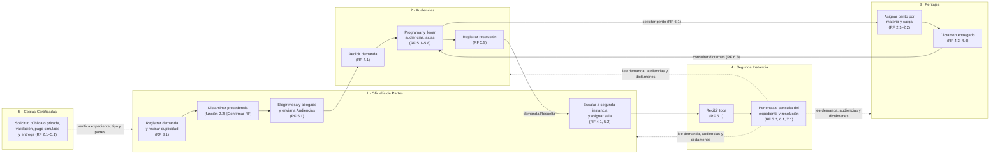
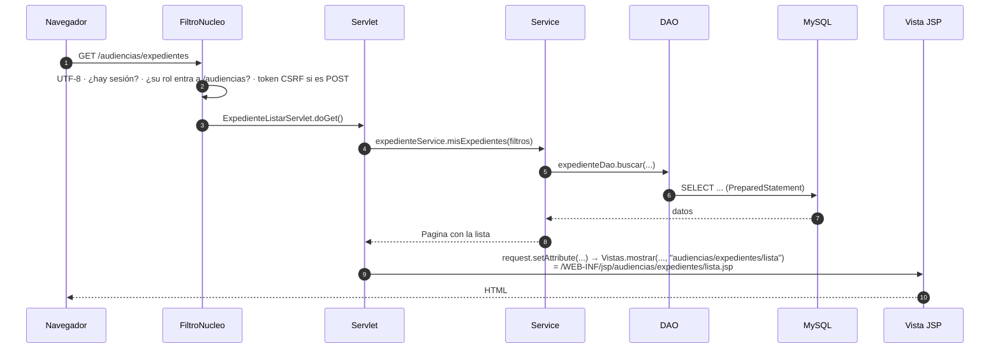
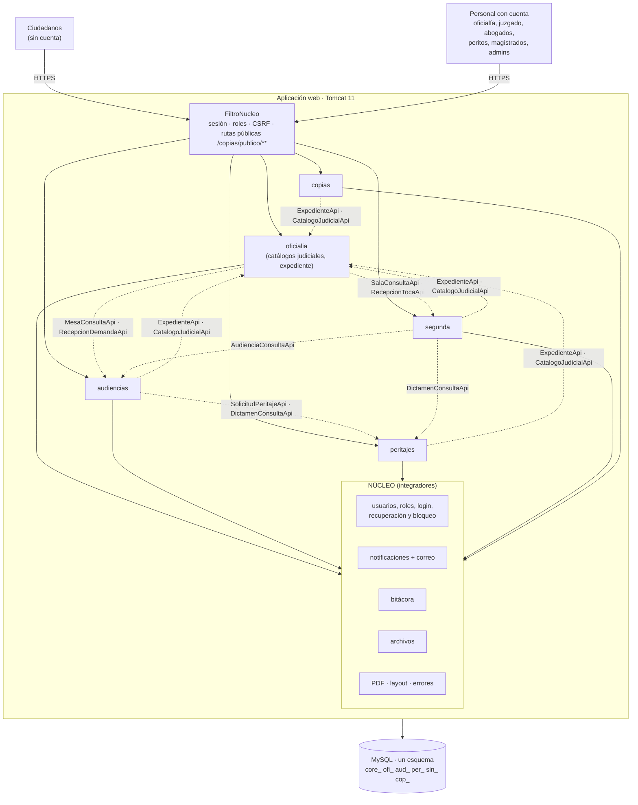
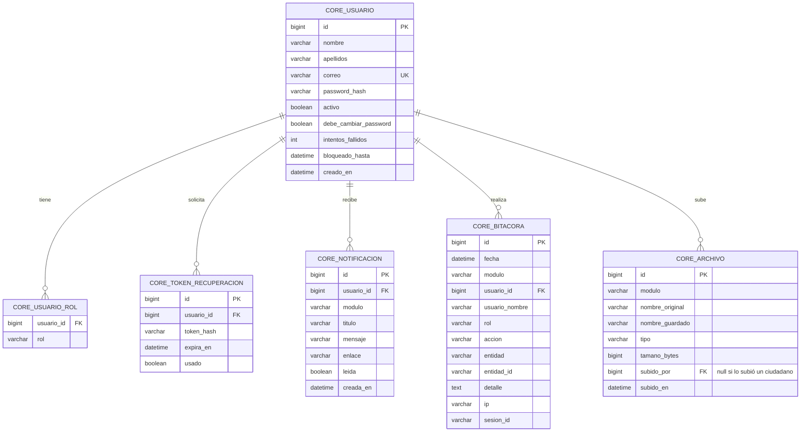

# Arquitectura del Sistema Judicial Integral

Versión 6.0 · 11/11/2026 · Basada en los DFR de los cinco módulos

> **Cambio de la versión 6.0:** el proyecto deja **Spring Boot** y pasa a **Jakarta EE 11 con Servlets y JSP** sobre **Tomcat 11** (se sigue usando MVC). Las pantallas se mueven de `front-end/` a **`src/main/webapp/`**, el acceso a datos pasa de JPA a **JDBC con DAO** y la seguridad la hace un **filtro propio**. Cambian las secciones 4, 5, 8, 9, 10, 11, 12, 14 y 16. Cómo pasar código hecho con Spring: `docs/MIGRACION_SPRING_A_SERVLETS.md`.

> **Nombre provisional.** No se tiene el nombre oficial del sistema completo. Aquí se usa **"Sistema Judicial Integral" (SIJ)**, el repositorio `sistema-judicial` y el paquete Java `mx.edu.utez.sij`. Cambiarlos antes de crear el repo.
>
> **Marcas que se usan en todos los documentos:**
> - **[Propuesta]**: idea de este documento que deben aprobar los integradores (un representante por equipo + líder).
> - **[Confirmar]**: algo que los DFR no dicen o dicen distinto entre sí. Lo resuelve el equipo dueño con el cliente.
>
> **Criterio:** tecnologías básicas vistas en la carrera (Java, Servlets y JSP con MVC, y una base de datos relacional).

---

## Índice

1. Qué es este proyecto
2. Módulos y equipos
3. Recorrido de una demanda por el sistema
4. Tecnologías
5. Cómo funciona una petición (MVC con servlets)
6. Arquitectura general
7. El núcleo común
8. Reglas para que los módulos convivan
9. Contratos entre módulos
10. Seguridad
11. Base de datos
12. Árbol del repositorio
13. GitHub
14. Sprint 0
15. Decisiones pendientes entre equipos
16. Front-end con JSP (carpeta `src/main/webapp/`)

---

## 1. Qué es este proyecto

Un solo sistema judicial con **5 módulos**, uno por equipo, dentro de **un solo proyecto web Jakarta EE (Servlets + JSP) y un solo repositorio de GitHub**. Todos los módulos comparten:

- el mismo inicio de sesión,
- la misma base de datos,
- el mismo diseño de pantallas.

Se comunican entre sí por **contratos** (interfaces de Java). Así, al final no hay que "unir" nada.

| Documento | Para qué |
| :---- | :---- |
| `docs/ARQUITECTURA.md` | Lo común a todo el sistema (este documento) |
| `docs/CONTRATOS.md` | Las interfaces exactas entre módulos |
| `docs/modulos/<modulo>.md` | Lo propio de cada módulo, a partir de su DFR |
| `docs/GUIA_PANTALLAS.md` | Cómo hacer las pantallas de tu módulo, explicado fácil |
| `docs/FLUJO_DE_TRABAJO.md` | Reglas de Git y reglas para asistentes de IA |
| `docs/GUIA_GITHUB.md` | Tutorial paso a paso de GitHub para todos los integrantes |
| `docs/FRONT_END.md` | Cómo hacer una pantalla nueva (resumen práctico) |
| `docs/MIGRACION_SPRING_A_SERVLETS.md` | Cómo pasar a servlets lo que se hizo con Spring Boot |

---

## 2. Módulos y equipos

| Equipo | Módulo | Nombre en su DFR | Líder (según DFR) | Prefijo |
| :---- | :---- | :---- | :---- | :---- |
| Equipo 1 | Oficialía de Partes | Sistema de Gestión y Recepción de Demandas para Oficialías de Partes | Flores Pérez Valeria Jatziry | `oficialia` / `ofi_` |
| Equipo 2 | Audiencias | SGCA – Sistema de Gestión y Control de Audiencias | Hernández Bautista Jimena | `audiencias` / `aud_` |
| Equipo 3 | Peritajes | SGPJ – Sistema para Gestión de Peritajes Judiciales | Contreras Carbajal Marco Antonio | `peritajes` / `per_` |
| Equipo 4 | Segunda Instancia | SSI – Sistema de Gestión de Tocas de Segunda Instancia | Modesto Cruz Bastián Azael | `segunda` / `sin_` |
| Equipo 5 | Copias Certificadas | SGCC – Sistema de Gestión de Copias Certificadas | Sánchez Muñoz Emilio | `copias` / `cop_` |
| Integradores | Núcleo común | — | Un representante por equipo + líder general: **Contreras Carbajal Marco Antonio** | `nucleo` / `core_` |

Cliente de los cinco módulos: **Narváez Figueroa José Christian**.

El **prefijo** se usa siempre igual:

| Dónde | Regla | Ejemplo |
| :---- | :---- | :---- |
| Paquete Java | `mx.edu.utez.sij.<prefijo>` | `mx.edu.utez.sij.audiencias` |
| URL | `/<prefijo>/...` | `/audiencias/agenda` |
| Vistas (JSP) | `src/main/webapp/WEB-INF/jsp/<prefijo>/` | `src/main/webapp/WEB-INF/jsp/audiencias/agenda.jsp` |
| CSS, JS e imágenes | `src/main/webapp/recursos/<prefijo>/` | `src/main/webapp/recursos/audiencias/js/agenda.js` |
| Tablas | `<pre>_<nombre>` | `aud_audiencia` |
| Roles | `<PREFIJO>_<ROL>` | `AUDIENCIAS_ABOGADO` |

---

## 3. Recorrido de una demanda por el sistema

Así se conectan los cinco DFR. Cada paso dice qué módulo lo hace y con qué requerimiento (RF).



**Primera instancia**

1. **Oficialía** registra la demanda y el sistema busca posibles duplicados. El personal del juzgado decide si es procedente o improcedente.
2. **Oficialía** pide a Audiencias las mesas de la materia con sus abogados, elige uno y le envía la demanda.
3. **Audiencias** recibe la demanda en el listado del abogado y programa las audiencias que hagan falta (con su acta descargable y su acta firmada).
4. **Audiencias** puede pedir un perito del sistema. **Peritajes** asigna al perito de menor carga, y cuando el perito entrega el dictamen, Audiencias lo consulta.
5. **Audiencias** registra la resolución y la demanda queda finalizada en primera instancia.

**Segunda instancia**

6. Si hay inconformidad, **Oficialía** marca la demanda "En Segunda Instancia" y le asigna una sala (que administra Segunda Instancia).
7. **Segunda Instancia** genera la toca. El magistrado registra ponencias, consulta el expediente completo de los otros tres módulos y emite su resolución.

**En cualquier momento**

8. Cualquier persona puede pedir **copias certificadas** en un portal público, sin cuenta:
   - si la demanda es **pública**, pasa directo al pago (simulado);
   - si es **privada**, el personal del juzgado valida que el solicitante sea parte de la demanda.

   Después el juez o el personal del juzgado registra la entrega física.

---

## 4. Tecnologías

| Para qué | Tecnología | Nota |
| :---- | :---- | :---- |
| Lenguaje | **Java 21** | |
| Plataforma | **Jakarta EE 11**: **Servlets 6.1** + **JSP 4** + **JSTL 3** | Patrón **MVC** sin framework: servlet (controlador) → service → DAO → JSP (vista). Un solo proyecto Maven que genera un `.war` |
| Servidor | **Apache Tomcat 11** | Todos la misma versión. Tomcat 10 no sirve: las JSP usan `record` y eso necesita EL 6 |
| Pantallas | **JSP** + **JSTL** + **Bootstrap 5** | En `src/main/webapp/` (sección 16). HTML generado en el servidor; Bootstrap por CDN |
| Base de datos | **MySQL 8** | Un solo esquema `sij` |
| Acceso a datos | **JDBC** con **DAO** + pool **HikariCP** | SQL escrito a mano con `PreparedStatement`. Conexión en `nucleo.bd.ConexionBD` |
| Seguridad | **Filtro propio** (`FiltroNucleo`) con sesión, roles por URL y token CSRF | Sin librerías de seguridad (sección 10) |
| Contraseñas | **PBKDF2** (`PBKDF2WithHmacSHA256`, incluido en Java) | Sin librerías extra. Nunca SHA-256 simple |
| Validaciones | **Jakarta Validation** (Hibernate Validator) | `@NotBlank`, `@Email`, `@Size`, `@Pattern` en los formularios; se revisan con `Validador.validar(form)` |
| Correo | **Jakarta Mail** [Propuesta] | Recuperación de contraseña y avisos. Solo dentro del núcleo; apagado en desarrollo |
| PDF | **Thymeleaf** (solo la librería) + **OpenHTMLtoPDF** [Propuesta] | Solo dentro del núcleo (`PdfService`): plantilla HTML → PDF. Lo usan Audiencias (acta) y Copias (papeleta y comprobante). Thymeleaf **nunca** para pantallas |
| Limpiar HTML | **Jsoup** | Solo para el texto del editor del dictamen (Peritajes) |
| Editor de texto | **Quill** por CDN | Solo Peritajes (dictamen) |
| Calendario | **FullCalendar** por CDN [Propuesta] | Solo Audiencias (agenda). Opcional: también sirve una tabla por día |
| Pruebas | **JUnit 5** | Para services y DAOs en memoria |

Las versiones exactas están en el `pom.xml` (lo mantienen los integradores; **los equipos no agregan dependencias**).

**No se usa:** Spring, Spring Boot, JPA/Hibernate ORM, Lombok, Vue/React/Angular, JWT, Docker, Flyway, microservicios, API REST entre módulos ni pasarelas de pago reales.

> **Sobre las "API REST" de los DFR.** Varios DFR dicen que los módulos se comunican "mediante API REST con JSON". Como todos viven en el mismo proyecto, esa comunicación se hace con **interfaces de Java** (sección 9), que son más simples y no necesitan servidores separados. En cada documento de módulo está el texto sugerido para corregir su DFR.

---

## 5. Cómo funciona una petición (MVC con servlets)



| Capa | Paquete | Qué hace | Qué NO hace |
| :---- | :---- | :---- | :---- |
| Controlador | `controller` | Un **servlet por pantalla o acción** (`@WebServlet`). Lee parámetros, valida el formulario, revisa el permiso fino, llama al service y muestra la vista o redirige | Reglas de negocio ni SQL |
| Service | `service` | Reglas de negocio del DFR y transacciones | Saber de HTML, `request` o `response` |
| DAO | `dao` | Interfaz + clase con SQL (`PreparedStatement`) | Reglas |
| Model | `model` | Clases de las tablas y `enum` de estados | — |
| DTO | `dto` | Formularios (con anotaciones de validación) y datos para las vistas | — |
| Vista | `src/main/webapp/WEB-INF/jsp/<prefijo>/` | HTML con JSP, JSTL y EL | Lógica ni código Java (*scriptlets*) |

**Cada módulo arma sus objetos en una sola clase** (no hay inyección de dependencias). Ejemplo real de Peritajes:

```java
// peritajes/Peritajes.java
public final class Peritajes {
    private static final PeritoDao PERITO_DAO = new PeritoDaoMemoria();   // luego: new PeritoDaoMySql()
    private static final PeritoService PERITO_SERVICE = new PeritoService(PERITO_DAO, new CatalogoMateriasTemporal());

    public static PeritoService peritoService() { return PERITO_SERVICE; }
}

// En un servlet:
private final PeritoService peritoService = Peritajes.peritoService();
```

Cambiar de la versión en memoria a la de MySQL es cambiar **una línea** en esa clase.

**Herramientas del núcleo para los servlets** (`nucleo/web/`, ya hechas):

| Clase | Uso |
| :---- | :---- |
| `Vistas` | `Vistas.mostrar(request, response, "peritajes/peritos/lista")` (forward a la JSP) · `Vistas.redirigir(request, response, "/peritajes/peritos")` (agrega la ruta base) · `Vistas.noEncontrado(response)` (404) |
| `Parametros` | `texto`, `numero`, `entero`, `booleano`, `numeros` (casillas) y `lista` (`campo[0]`, `campo[1]`...). Nunca lanzan excepción: si no se puede convertir, regresan `null` o el valor por omisión |
| `Validador` | `Map<String, String> errores = Validador.validar(form)` (campo → mensaje) |
| `FlashMessage` | `FlashMessage.exito(request, "Registro exitoso", detalle)` y `FlashMessage.error(request, mensaje)`: sobreviven a **una** redirección |
| `Pagina<T>` | Resultado paginado: `Pagina.de(lista, numero, tamano)` en memoria y `Pagina.offset(numero, tamano)` para `LIMIT ? OFFSET ?` |

**Servlet típico de formulario (patrón Post/Redirect/Get):**

```java
@WebServlet("/peritajes/peritos/nuevo")
public class PeritoRegistrarServlet extends HttpServlet {

    private final PeritoService peritoService = Peritajes.peritoService();

    @Override
    protected void doGet(HttpServletRequest request, HttpServletResponse response) throws ServletException, IOException {
        request.setAttribute("peritoForm", new PeritoForm());
        Vistas.mostrar(request, response, "peritajes/peritos/registro");
    }

    @Override
    protected void doPost(HttpServletRequest request, HttpServletResponse response) throws ServletException, IOException {
        PeritoForm form = PeritoFormSupport.leer(request);          // lee los parámetros
        Map<String, String> errores = Validador.validar(form);      // @NotBlank, @Email...
        if (errores.isEmpty()) {
            try {
                Perito perito = peritoService.registrar(form);
                FlashMessage.exito(request, "Registro exitoso", perito.getNombreCompleto() + " quedó Activo.");
                Vistas.redirigir(request, response, "/peritajes/peritos");   // ← redirección después de guardar
                return;
            } catch (ReglaNegocioException e) {
                request.setAttribute("error", e.getMessage());
            }
        }
        request.setAttribute("errores", errores);                   // la JSP los muestra con <n:error campo="..."/>
        request.setAttribute("peritoForm", form);                   // para no borrar lo que escribió
        Vistas.mostrar(request, response, "peritajes/peritos/registro");
    }
}
```

**Rutas con id:** los servlets no leen partes de la URL; el id va como parámetro: `/peritajes/peritos/editar?id=5` (no `/peritajes/peritos/5/editar`). Cada servlet tiene una ruta fija.

**Datos de prueba al arrancar:** cada módulo puede tener una clase `Arranque<Modulo>` con `@WebListener`. Mientras un módulo guarda en memoria, ahí carga sus datos de prueba (`DatosIniciales<Modulo>`). Con MySQL, los datos de prueba van en el script SQL del módulo (sección 11).

---

## 6. Arquitectura general

**Monolito modular:** una sola aplicación web (un `.war` en Tomcat) dividida en paquetes por módulo.



Cada flecha punteada es un contrato. Va **del módulo que lo usa al que lo implementa** (detalle en `docs/CONTRATOS.md`).

---

## 7. El núcleo común (`nucleo`)

Lo que **todos** los DFR piden se hace una sola vez. Ningún módulo hace su propio login, su tabla de usuarios, sus correos, su bitácora, su subida de archivos ni su generación de PDF.

Los módulos obtienen los servicios del núcleo desde una sola clase, igual que cada módulo arma los suyos: `Nucleo.bitacora()`, `Nucleo.archivos()`, etc. [Propuesta]

| Servicio | Qué ofrece | Lo piden |
| :---- | :---- | :---- |
| Control de acceso | Login, cerrar sesión, recuperar y cambiar contraseña, bloqueo por intentos | Los 5 DFR (RF 1.x) |
| `UsuarioService` | Crear usuarios, dar y quitar roles, desactivar y reactivar | Todos los que dan de alta personal |
| `SesionService` | Usuario en sesión: id, nombre, roles | Todos |
| `NotificacionService` | Aviso en la campana + correo | Peritajes, Segunda Instancia (los demás lo pospusieron) |
| `BitacoraService` | Registro inalterable con usuario, rol, acción, entidad, fecha e IP | Peritajes 5.2, Audiencias 7.1–7.2, Segunda 6.2 |
| `ArchivoService` | Subir con validación de tipo y tamaño, descargar con permiso | Todos |
| `PdfService` | Plantilla HTML (Thymeleaf) → PDF descargable | Audiencias 5.7, Copias 2.3 y 4.1 |
| Layout (`src/main/webapp/WEB-INF/tags/`) | Menú por rol, campana, mensajes, diseño institucional, layout público, paginación | Todos |

### 7.1 Control de acceso unificado

Los cinco DFR describen su propio login con reglas parecidas pero no iguales. Como el login es uno solo, se unifican así:

| Regla | Valor unificado | De dónde sale |
| :---- | :---- | :---- |
| Datos de entrada | Correo electrónico y contraseña | Todos (Copias también menciona "usuario"; se usa el correo) |
| Quién entra | Solo usuarios registrados y **activos** | Todos |
| Mensajes | "Credenciales incorrectas" · "Cuenta inactiva" · "Cuenta bloqueada temporalmente" | Audiencias 1.1 |
| Intentos fallidos | **3 intentos → bloqueo de 15 minutos** | Audiencias, Segunda, Copias |
| Recuperar contraseña | Enlace por correo, **vigente 15 minutos y de un solo uso** | Audiencias 1.2, Copias 1.3, Segunda 1.2 |
| Mensaje si el correo no existe | **Mismo mensaje en ambos casos:** "Si el correo está registrado, recibirás las instrucciones" [Propuesta] | Segunda 1.2 lo pide así por seguridad; Audiencias y Copias piden decir que no existe (ver sección 15) |
| Nueva contraseña | Mínimo **8 caracteres**, una mayúscula, una minúscula y un número; **distinta a la actual**; confirmación igual | Audiencias 1.3, Copias 1.3 |
| Cerrar sesión | Invalida la sesión. El botón "Atrás" no muestra páginas privadas | Audiencias 1.4, Copias 1.2 |
| Sesión inactiva | **30 minutos** por defecto; **configurable por rol** (`SEGUNDA_MAGISTRADO` = 8 horas) [Propuesta] | Audiencias 1.4; Segunda pide sesión extendida por las ponencias |
| Primer inicio de sesión | Si la cuenta se creó con contraseña temporal, obliga a cambiarla | Peritajes, Segunda 4.1 |
| Ciudadanos | **No tienen cuenta**: usan el portal público de Copias | Decisión del grupo |

En desarrollo el correo está apagado: el enlace de recuperación y la contraseña temporal **se imprimen en la consola** para poder probar.

### 7.2 Roles

Un usuario puede tener roles de varios módulos. En el menú solo ve los módulos de sus roles.

| Rol | Módulo | Quién es (según su DFR) |
| :---- | :---- | :---- |
| `SISTEMA_ADMIN` | Núcleo / Oficialía | **Administrador Mayor** de Oficialía: configura materias, distritos, juzgados y oficialías, y da de alta a los administradores de cada módulo [Propuesta] |
| `OFICIALIA_PERSONAL` | Oficialía | Personal de Oficialía de Partes |
| `OFICIALIA_REVISOR` | Oficialía | Personal del juzgado / revisor de procedencia |
| `AUDIENCIAS_ADMIN` | Audiencias | Administrador de audiencias |
| `AUDIENCIAS_ABOGADO` | Audiencias | Abogado de audiencia (equivalente al juez) |
| `PERITAJES_ADMIN` | Peritajes | Administrador |
| `PERITAJES_PERITO_ADMIN` | Peritajes | Perito Administrador |
| `PERITAJES_PERITO` | Peritajes | Perito |
| `SEGUNDA_ADMIN` | Segunda Instancia | Administrador de salas y magistrados |
| `SEGUNDA_MAGISTRADO` | Segunda Instancia | Magistrado |
| `COPIAS_PERSONAL` | Copias | Personal administrativo del juzgado (visto bueno) |
| `COPIAS_JUEZ` | Copias | Juez / autoridad (registra la entrega) |

### 7.3 Quién da de alta a quién

| Quién | Crea usuarios con rol | Dónde (según su DFR) |
| :---- | :---- | :---- |
| `SISTEMA_ADMIN` | Administradores de cada módulo, `COPIAS_PERSONAL`, `COPIAS_JUEZ` y el primer `OFICIALIA_PERSONAL` de cada oficialía | `/admin/usuarios` (núcleo) |
| `OFICIALIA_PERSONAL` | `OFICIALIA_PERSONAL` y `OFICIALIA_REVISOR` **solo de su propia oficialía** | Oficialía RF 2.3 |
| `AUDIENCIAS_ADMIN` | `AUDIENCIAS_ABOGADO` | Audiencias RF 3.1 |
| `PERITAJES_ADMIN` / `PERITAJES_PERITO_ADMIN` | `PERITAJES_PERITO` | Peritajes RF 3.1 |
| `SEGUNDA_ADMIN` | `SEGUNDA_MAGISTRADO` | Segunda RF 4.1 |

Cada módulo crea las cuentas con `usuarioService.crear(...)` del núcleo. Solo puede dar **roles de su propio módulo**. Al dar de baja a alguien en un módulo se le quita ese rol, y si ya no le queda ninguno, su cuenta se desactiva.

### 7.4 Bitácora

Una sola tabla (`core_bitacora`) con columna `modulo`. Cada módulo muestra solo sus registros.

- **Datos de cada registro:**
  - fecha y hora del servidor,
  - módulo,
  - usuario (id y nombre),
  - rol,
  - acción,
  - entidad y su id,
  - detalle,
  - IP,
  - id de sesión.

  Son los seis datos obligatorios de Audiencias 7.1, más el módulo.
- **Inalterable:** no existen métodos ni pantallas para editar o borrar registros.
- **Si no se puede registrar, la acción no se completa** (Audiencias 7.1). `bitacora.registrar(con, ...)` recibe la misma conexión de la transacción del service: si falla, se revierte todo (sección 11).
- **Llamadas entre módulos:** cuando un módulo actúa por otro (por ejemplo, Oficialía envía una demanda a Audiencias), se registra con el usuario en sesión y en el detalle `origen: OFICIALIA`.

### 7.5 Archivos

`archivoService.guardar(modulo, archivo, tiposPermitidos, tamanoMaximoMB)`:
- valida la extensión y el tipo del archivo,
- guarda el archivo con un nombre aleatorio fuera de las carpetas públicas (nunca dentro de `src/main/webapp/`),
- y devuelve el id de `core_archivo`.

Cada módulo define sus propios límites:

| Módulo | Archivo | Tipos | Tamaño máximo |
| :---- | :---- | :---- | :---- |
| Oficialía | Documentos de la demanda | [Confirmar] (propuesta: PDF, JPG, PNG) | [Confirmar] (propuesta: 10 MB) |
| Audiencias | Acta firmada | PDF o imagen | 5 MB |
| Peritajes | Documentos del dictamen | PDF, Word, PNG, JPEG | 25 MB |
| Segunda Instancia | Apelación y resolución | PDF | [Confirmar] (propuesta: 10 MB) |
| Copias | Identificación oficial (INE) | JPG, PNG, PDF | [Confirmar] (propuesta: 5 MB) |

**Para descargar** se usa siempre una ruta del módulo que muestra el archivo. Esa ruta revisa el permiso y luego llama a `archivoService.descargar(id)`. No existe una ruta pública de archivos.

### 7.6 Rutas del núcleo

| Método | URL | Quién | Qué hace |
| :---- | :---- | :---- | :---- |
| GET / POST | `/login` | Público | Iniciar sesión |
| POST | `/logout` | Con sesión | Cerrar sesión |
| GET / POST | `/recuperar` | Público | Pedir enlace de recuperación |
| GET / POST | `/recuperar/nueva?token=...` | Público | Escribir la nueva contraseña |
| GET / POST | `/cuenta/password` | Con sesión | Cambiar contraseña |
| GET | `/` | Con sesión | Inicio con una tarjeta por módulo al que tiene acceso |
| GET | `/notificaciones` | Con sesión | Sus notificaciones |
| POST | `/notificaciones/leida` (con `id`) | Con sesión | Marcar como leída |
| GET / POST | `/admin/usuarios/**` | `SISTEMA_ADMIN` | Administración general de usuarios |

### 7.7 Tablas del núcleo



Las **materias, distritos, municipios y juzgados** no están en el núcleo. Son de Oficialía, porque su DFR (RF 2.1 y 2.2) dice que el Administrador Mayor los configura. Los demás módulos los consultan con `CatalogoJudicialApi`.

---

## 8. Reglas para que los módulos convivan

1. **Paquete:** todo tu código Java va en `mx.edu.utez.sij.<prefijo>`.
2. **URLs:** todas tus rutas (`@WebServlet`) empiezan con `/<prefijo>/`. Solo Copias tiene rutas públicas, en `/copias/publico/**`. El id va como parámetro (`?id=5`).
3. **Vistas** en `src/main/webapp/WEB-INF/jsp/<prefijo>/` y CSS, JS e imágenes en `src/main/webapp/recursos/<prefijo>/` (sección 16).
4. **Tablas:** `<pre>_<nombre>`, creadas en tu script `bd/NN_<prefijo>.sql` (sección 11).
5. **Nunca** uses un DAO, service o clase de `model` de otro módulo. Solo el núcleo y los contratos (`docs/CONTRATOS.md`).
6. **Relaciones entre tablas:**
   - Con tablas `core_*`, sí (llave foránea).
   - Con otro módulo, no: guarda solo su identificador (por ejemplo, `numero_expediente` o `materia_id`) como columna simple.
7. **Identificador común:** el **número de expediente** que genera Oficialía. Todos los módulos lo llaman `numeroExpediente` en Java y `numero_expediente` en la base.
8. **Permisos:** el permiso por módulo lo revisa `FiltroNucleo`; el permiso fino, al inicio de cada servlet. Nadie edita `FiltroNucleo` ni `web.xml`.
9. **Formularios:** `GET` para ver y `POST` para guardar, cambiar o borrar. Después de un `POST` exitoso, **siempre redirigir** (Post/Redirect/Get).
10. **Mensajes al usuario:** `FlashMessage.exito(...)` / `FlashMessage.error(...)` antes de redirigir, o `request.setAttribute("error", ...)` si se vuelve a mostrar la misma pantalla, con los textos exactos de los criterios de aceptación del DFR.
11. **Errores de contratos:** todos los errores de negocio extienden `ReglaNegocioException` (núcleo). Quien llama un contrato atrapa esa excepción y muestra `e.getMessage()`.
12. **Fechas:** `LocalDate` / `LocalDateTime` con la zona `America/Mexico_City`.
13. **Paginación:** `Pagina<T>` del núcleo con el tamaño que diga cada DFR (Audiencias 10, Peritajes 25); en SQL, `LIMIT ? OFFSET ?`.
14. **SQL:** solo con `PreparedStatement` y `?`; conexiones siempre en `try-with-resources`.
15. **Nombres en español**, sin acentos en el código. Servlets: `<Entidad><Accion>Servlet` (`PeritoRegistrarServlet`); DAO: `<Entidad>Dao` (interfaz) y `<Entidad>DaoMySql` / `<Entidad>DaoMemoria`.

---

## 9. Contratos entre módulos

Un **contrato** es una interfaz de Java en `nucleo/contratos/<modulo>/`. El módulo dueño la implementa y la **registra al arrancar** en `nucleo/contratos/Contratos`; los demás la piden ahí cuando la necesitan (`Contratos.mesaConsulta().mesasDisponibles(materiaId)`) [Propuesta]. El detalle completo, con métodos y datos, está en **`docs/CONTRATOS.md`**.

| Contrato | Lo implementa | Lo usa | Para qué (RF) |
| :---- | :---- | :---- | :---- |
| `CatalogoJudicialApi` | Oficialía | Todos | Materias, distritos y juzgados (Oficialía 2.1, 2.2; Segunda 2.1) |
| `ExpedienteApi` | Oficialía | Audiencias, Peritajes, Segunda, Copias | Datos de la demanda, partes, tipo público/privado, documentos y cambio de estado |
| `MesaConsultaApi` | Audiencias | Oficialía | Mesas activas de una materia con sus abogados (Audiencias 3.3) |
| `RecepcionDemandaApi` | Audiencias | Oficialía | Enviar la demanda al abogado elegido (Audiencias 4.1; Oficialía 5.1) |
| `AudienciaConsultaApi` | Audiencias | Segunda | Audiencias, actas y resolución de primera instancia (Segunda 6.1) |
| `SolicitudPeritajeApi` | Peritajes | Audiencias | Pedir y cancelar peritajes y ver su estado (Peritajes 2.1–2.4; Audiencias 6.1, 6.4) |
| `DictamenConsultaApi` | Peritajes | Audiencias, Segunda | Leer dictámenes entregados (Peritajes 4.5; Audiencias 6.3; Segunda 6.1) |
| `SalaConsultaApi` | Segunda | Oficialía | Salas activas con su magistrado (Oficialía 5.2) |
| `RecepcionTocaApi` | Segunda | Oficialía | Crear la toca (Segunda 5.1; Oficialía 4.1, 5.2) |

Copias no ofrece contratos: solo usa los de Oficialía.

---

## 10. Seguridad

Todo pasa por **`nucleo/web/FiltroNucleo`** (`@WebFilter("/*")`), que mantienen los integradores. Funciona como **lista blanca**: lo que no está permitido, se niega.

| Tema | Cómo se hace |
| :---- | :---- |
| Inicio de sesión | Servlet `/login` del núcleo. Al entrar se **invalida la sesión anterior y se crea una nueva** (evita que alguien fije la sesión) y se guarda el usuario en la sesión (`usuarioSesion`: id, nombre y roles) [Pendiente del núcleo] |
| Rutas | En `FiltroNucleo`: públicas solo `/login`, `/recuperar`, `/recursos/**` y `/copias/publico/**`. Sin sesión, todo lo demás redirige a `/login` |
| Permiso por módulo | En `FiltroNucleo`: a `/<prefijo>/**` solo entra quien tiene un rol de ese módulo (por ejemplo, `/peritajes/**` exige un rol `PERITAJES_*`); si no, 403 [Pendiente del núcleo] |
| Permiso por pantalla | Al inicio de cada servlet, el núcleo dará un ayudante tipo `if (!Acceso.exigir(request, response, "PERITAJES_ADMIN")) return;` que responde 403 [Propuesta] |
| Contraseñas | **PBKDF2** con `PBKDF2WithHmacSHA256` de Java, 600 000 iteraciones y *salt* aleatorio de 16 bytes; se guarda como `pbkdf2$iteraciones$salt$hash` en `password_hash`. Se compara con `MessageDigest.isEqual`. Nunca en texto plano, ni SHA-256 simple, ni en logs |
| Bloqueo | 3 intentos fallidos → 15 minutos (`intentos_fallidos`, `bloqueado_hasta`) |
| Recuperación | Token aleatorio (`SecureRandom`) guardado como hash, 15 minutos, un solo uso |
| CSRF | **Ya funciona.** `FiltroNucleo` crea un token por sesión y responde **403** a todo `POST` sin él. Todo `<form method="post">` lleva `<n:csrf/>` (también en el portal público); los `fetch` con `POST` mandan `SIJ.encabezadosCsrf()` |
| Encabezados | `FiltroNucleo` ya agrega `X-Content-Type-Options: nosniff`, `X-Frame-Options: DENY`, `Referrer-Policy: same-origin` y `Cache-Control: no-store` (el botón "Atrás" no muestra páginas privadas después de cerrar sesión) |
| Cookie de sesión | `http-only`, solo por cookie (nunca `;jsessionid=` en la URL) y 30 minutos (`web.xml`). Para `SEGUNDA_MAGISTRADO`, el login usa `session.setMaxInactiveInterval(8 * 60 * 60)` [Propuesta] |
| Menú por rol | En las JSP con `<c:if>` sobre los roles del usuario en sesión [Pendiente del núcleo]. Ocultar una opción **no** es el permiso: el permiso real está en el filtro y en el servlet |
| Datos propios | El service filtra por el usuario en sesión: el abogado ve sus expedientes, el perito sus casos, el magistrado sus tocas y Oficialía su adscripción. Si alguien pide algo ajeno (cambiando el `?id=`), ve el mensaje del DFR o la página 404 |
| Usuario desactivado | No inicia sesión; el núcleo invalida sus sesiones abiertas |
| Portal público (Copias) | Solo `/copias/publico/**`. Sin datos de otros: con un folio se ve solo el estado del trámite. Los folios llevan una parte aleatoria para que no se puedan adivinar |
| Datos privados | La INE y el RFC de los solicitantes solo los ve `COPIAS_PERSONAL`. Los expedientes privados nunca se muestran en el portal |
| XSS | En JSP, `${...}` **no escapa**: todo dato se muestra con `<c:out value="${...}"/>`. Sin escapar solo el HTML ya limpiado con Jsoup (dictamen) |
| Inyección SQL | **Siempre `PreparedStatement` con `?`**. Nunca concatenar texto del usuario en el SQL. Para ordenar por una columna elegida, usar una lista fija de columnas permitidas |
| Archivos | `@MultipartConfig(maxFileSize = ...)` en el servlet (si se pasa, `FiltroNucleo` muestra la página 413), validación de tipo y tamaño, nombre aleatorio, guardados fuera de `src/main/webapp/`, descarga solo con permiso |
| Errores | Las páginas de `web.xml` (`403.jsp`, `404.jsp`, `413.jsp`, `500.jsp`) nunca muestran el detalle técnico |
| Bitácora | Sin edición ni borrado |
| Contraseñas del proyecto | En `src/main/resources/bd.properties`, que **no se sube** a GitHub (está en `.gitignore`). Tampoco se suben llaves, *wallets* ni `credentials.properties` |
| HTTPS | En el servidor de entrega. En local, `http://localhost:8080/sij` |

---

## 11. Base de datos

- **Un solo esquema** `sij` en MySQL 8.
- **Conexión:** siempre con el pool del núcleo, dentro de `try-with-resources` para que la conexión regrese al pool:

  ```java
  try (Connection con = ConexionBD.obtener();
       PreparedStatement ps = con.prepareStatement("SELECT id, nombre FROM per_perito WHERE id = ?")) {
      ps.setLong(1, id);
      try (ResultSet rs = ps.executeQuery()) { ... }
  }
  ```

  Los datos de la conexión se leen de `src/main/resources/bd.properties` (cada quien el suyo, a partir de `bd.example.properties`) o de las variables de entorno `SIJ_BD_URL`, `SIJ_BD_USUARIO` y `SIJ_BD_PASSWORD`.
- **Ids:** `BIGINT AUTO_INCREMENT`. Después del `INSERT`, el id se lee con `Statement.RETURN_GENERATED_KEYS` (nunca `SELECT MAX(id) + 1`).
- **Las tablas se crean con scripts SQL** (no hay JPA que las cree) [Propuesta]. Un archivo por dueño en la carpeta `bd/` de la raíz, y se ejecutan **en orden**:

  | Archivo | Dueño |
  | :---- | :---- |
  | `bd/00_nucleo.sql` | Integradores (crea el esquema `sij` y las tablas `core_*`) |
  | `bd/10_oficialia.sql` | Equipo 1 |
  | `bd/20_audiencias.sql` | Equipo 2 |
  | `bd/30_peritajes.sql` | Equipo 3 |
  | `bd/40_segunda.sql` | Equipo 4 |
  | `bd/50_copias.sql` | Equipo 5 |

  Cada archivo tiene sus `CREATE TABLE` y al final sus **datos de prueba** (`INSERT`). Así el orden es fijo: primero usuarios del núcleo, luego los catálogos de Oficialía y después los demás módulos.
- **Cambios a una tabla:** se escribe el `ALTER TABLE` al final del script del módulo con la fecha en un comentario, y se avisa en el PR para que todos lo ejecuten.
- **Llaves foráneas:** solo hacia tablas `core_*` o del propio módulo. Hacia otro módulo se guarda solo el identificador (por ejemplo, `numero_expediente`) como columna simple.
- **Transacciones** (cuando una acción hace varias escrituras, por ejemplo guardar + bitácora): las abre el **service** y le pasa la misma conexión a los DAOs. Regla: **los métodos de escritura del DAO reciben `Connection`; los de lectura abren la suya**.

  ```java
  try (Connection con = ConexionBD.obtener()) {
      con.setAutoCommit(false);
      try {
          peritoDao.guardar(con, perito);
          bitacora.registrar(con, "PERITAJES", "Registrar perito", ...);   // si falla, no se guarda nada
          con.commit();
      } catch (SQLException | RuntimeException e) {
          con.rollback();
          throw e;
      }
  }
  ```
- **Errores de SQL:** el DAO no los oculta (nada de `printStackTrace()` y regresar `null`). Los deja subir o los convierte en `ReglaNegocioException` cuando son de negocio (por ejemplo, correo duplicado).
- **Mientras no hay base de datos:** cada módulo puede tener su DAO en memoria (`<Entidad>DaoMemoria`), como Peritajes hoy. Las pruebas usan esa versión.
- Antes de la entrega, los integradores juntan los scripts en `docs/bd/esquema.sql`.

---

## 12. Árbol del repositorio

```text
sistema-judicial/
├── .github/
│   ├── CODEOWNERS
│   ├── pull_request_template.md
│   ├── copilot-instructions.md              # "Lee AGENTS.md"
│   ├── ISSUE_TEMPLATE/ (requerimiento.md, bug.md, contrato.md)
│   └── workflows/ci.yml                     # ./mvnw verify en cada PR
│
├── bd/                                      # scripts SQL (sección 11) [Propuesta]
│   ├── 00_nucleo.sql                        # INTEGRADORES
│   └── 10_oficialia.sql  20_audiencias.sql  30_peritajes.sql  40_segunda.sql  50_copias.sql
│
├── docs/
│   ├── ARQUITECTURA.md   CONTRATOS.md   FLUJO_DE_TRABAJO.md   GUIA_GITHUB.md
│   ├── GUIA_PANTALLAS.md   FRONT_END.md   MIGRACION_SPRING_A_SERVLETS.md
│   ├── bd/esquema.sql                       # al final
│   └── modulos/
│       ├── _PLANTILLA_MODULO.md
│       ├── oficialia.md   audiencias.md   peritajes.md   segunda-instancia.md   copias-certificadas.md
│       └── <prefijo>/                       # DFR y diseños originales de cada equipo
│
├── src/main/java/mx/edu/utez/sij/
│   ├── nucleo/                              # INTEGRADORES
│   │   ├── ArranqueNucleo.java              # @WebListener: cierra el pool al apagar
│   │   ├── bd/                # ConexionBD (HikariCP)
│   │   ├── web/               # FiltroNucleo, Vistas, Parametros, Validador, FlashMessage, CsrfToken,
│   │   │                      # Pagina, InicioServlet (/), ModuloSistema, UsuarioVista
│   │   ├── acceso/            # login, recuperación, cambio de contraseña, bloqueo, PBKDF2  (pendiente)
│   │   ├── usuarios/  notificaciones/  bitacora/  archivos/  pdf/                          (pendiente)
│   │   └── contratos/         # Contratos (registro), ReglaNegocioException + una carpeta por módulo
│   │       └── oficialia/  audiencias/  peritajes/  segunda/
│   ├── oficialia/             # EQUIPO 1
│   ├── audiencias/            # EQUIPO 2
│   ├── peritajes/             # EQUIPO 3
│   ├── segunda/               # EQUIPO 4
│   └── copias/                # EQUIPO 5
│       # cada módulo: controller/ service/ dao/ model/ dto/
│       #              <Modulo>.java (arma sus objetos) · Arranque<Modulo>.java (@WebListener, opcional)
│
├── src/main/resources/
│   ├── bd.example.properties                # ejemplo de conexión (sí se sube)
│   ├── bd.properties                        # el tuyo (NO se sube)
│   └── plantillas/            # SOLO plantillas internas de PDF y correo (no son pantallas)
│       ├── correo/<prefijo>/
│       └── pdf/<prefijo>/
│
├── src/main/webapp/                         # PANTALLAS (JSP) · sección 16
│   ├── WEB-INF/
│   │   ├── web.xml            # INTEGRADORES: sesión y páginas de error
│   │   ├── jsp/
│   │   │   ├── nucleo/        # INTEGRADORES: login, recuperar, inicio, cuenta, notificaciones, admin
│   │   │   ├── error/         # INTEGRADORES: 403.jsp, 404.jsp, 413.jsp, 500.jsp
│   │   │   ├── oficialia/     # EQUIPO 1
│   │   │   ├── audiencias/    # EQUIPO 2
│   │   │   ├── peritajes/     # EQUIPO 3
│   │   │   ├── segunda/       # EQUIPO 4
│   │   │   └── copias/        # EQUIPO 5
│   │   └── tags/
│   │       ├── layout.tag             # INTEGRADORES: plantilla con menú
│   │       ├── layout-publico.tag     # INTEGRADORES: plantilla del portal de Copias y errores
│   │       ├── nucleo/                # INTEGRADORES: mensajes, error, paginación, estado, confirmar, archivo...
│   │       └── <prefijo>/             # (opcional) componentes propios de cada equipo
│   └── recursos/
│       ├── nucleo/            # INTEGRADORES: css/estilos.css, js/comun.js, img/
│       └── oficialia/  audiencias/  peritajes/  segunda/  copias/   # css/ js/ img/ de cada equipo
│
├── src/test/java/mx/edu/utez/sij/           # misma estructura
├── pom.xml   mvnw   mvnw.cmd   .mvn/        # INTEGRADORES
├── .gitignore   .gitattributes
├── AGENTS.md   CLAUDE.md   README.md
```

**Configuración (solo la editan los integradores):**

| Archivo | Qué tiene |
| :---- | :---- |
| `pom.xml` | Empaquetado `war`, Java 21 y las dependencias de la sección 4. El `.war` se llama `sij.war` |
| `src/main/webapp/WEB-INF/web.xml` | Sesión de 30 minutos con cookie `http-only`, JSP en UTF-8 y páginas de error. Los servlets **no** se registran aquí: llevan `@WebServlet` |
| `src/main/resources/bd.example.properties` | Ejemplo de conexión a MySQL |

`bd.properties` (cada quien el suyo; **no se sube**):

```properties
bd.url=jdbc:mysql://localhost:3306/sij?serverTimezone=America/Mexico_City
bd.usuario=root
bd.password=tu_password
```

**Correr el proyecto:**

1. Instalar **Tomcat 11** (descargar el `.zip` de tomcat.apache.org y descomprimirlo).
2. En IntelliJ: *Run → Edit Configurations → + → Tomcat Server → Local*, elegir la carpeta de Tomcat 11; en *Deployment* agregar el artefacto **`sij:war exploded`** con *Application context* **`/sij`**. (IntelliJ Community no trae Tomcat: instalar el plugin **Smart Tomcat** y usar la misma carpeta y el mismo contexto.)
3. Copiar `bd.example.properties` como `bd.properties` cuando el módulo ya use MySQL.
4. Ejecutar y abrir **`http://localhost:8080/sij/`**.

Sin IntelliJ: `./mvnw verify` genera `target/sij.war`; se copia a la carpeta `webapps/` de Tomcat y se arranca con `bin/startup` (`startup.bat` en Windows).

> Todos usan el mismo contexto `/sij`. Como los enlaces se escriben con `<c:url>`, la ruta base se agrega sola.

---

## 13. GitHub

- Cómo se configura el repositorio y cómo trabaja cada integrante: **`docs/GUIA_GITHUB.md`**.
- Las reglas obligatorias para personas y asistentes de IA: **`docs/FLUJO_DE_TRABAJO.md`**.

Resumen del modelo de ramas:

```text
main  ←  develop  ←  equipo-N  ←  equipo-N/<tarea>
(entrega)  (los 5 módulos)  (cada equipo)  (cada integrante)
```

---

## 14. Sprint 0 (integradores)

1. Proyecto Maven `war` con las dependencias de la sección 4 y los paquetes de los 5 módulos.
2. Núcleo funcionando:
   - login con PBKDF2,
   - recuperación y cambio de contraseña,
   - bloqueo por intentos,
   - usuarios y roles,
   - permisos por módulo en `FiltroNucleo` y el ayudante de permisos por pantalla,
   - notificaciones,
   - bitácora,
   - archivos,
   - PDF,
   - layout privado y público (`layout.tag`, `layout-publico.tag`) y los componentes de `tags/nucleo/`,
   - páginas de error.
3. `bd/00_nucleo.sql` con usuarios de prueba que tengan un rol de cada módulo.
4. Todas las interfaces de `docs/CONTRATOS.md`, cada una con una clase de **datos de prueba** en el módulo dueño (`// TODO equipo N`) registrada en `Contratos`.
5. Página `/` con tarjetas por módulo, y una página de inicio en cada módulo (`WEB-INF/jsp/<prefijo>/inicio.jsp` + su servlet) que sirva de ejemplo para copiar.
6. `web.xml`, `ConexionBD`, `bd.example.properties` y comprobar que el proyecto corre en Tomcat 11 desde IntelliJ.
7. `.gitignore`, CI, CODEOWNERS, plantilla de PR, `AGENTS.md` y `docs/`.
8. Cada equipo revisa su `docs/modulos/<modulo>.md` y su sección de "Correcciones sugeridas al DFR".

**Avance (11/11/2026):**

| Punto | Estado |
| :---- | :---- |
| 1. Proyecto `war` con Jakarta EE 11 (migrado desde Spring Boot) | ✅ Hecho |
| 2. `FiltroNucleo` con CSRF y encabezados de seguridad; `Vistas`, `Parametros`, `Validador`, `FlashMessage`, `Pagina` | ✅ Hecho |
| 2. Layout privado y público, componentes de `tags/nucleo/` y páginas de error | ✅ Hecho |
| 5. Página `/` con tarjetas, e `inicio.jsp` + `menu.jsp` + servlet de inicio en cada módulo | ✅ Hecho |
| 6. `web.xml`, `ConexionBD` y `bd.example.properties` | ✅ Hecho |
| 7. `AGENTS.md`, `docs/` y CI | ✅ Hecho |
| 2. Login, usuarios, permisos por rol, notificaciones, bitácora, archivos y PDF | Pendiente |
| 3 y 4. Scripts SQL, usuarios de prueba y contratos | Pendiente |
| Base de datos | Pendiente: Peritajes guarda en memoria (`PeritoDaoMemoria`) |

---

## 15. Decisiones pendientes entre equipos

Son puntos donde dos o más DFR no coinciden o les falta algo para conectarse. Cada uno tiene una sugerencia; lo deciden los equipos involucrados (con el cliente si hace falta) y después se actualizan sus DFR.

| # | Tema | Qué dice cada DFR | Sugerencia | Equipos |
| :---- | :---- | :---- | :---- | :---- |
| 1 | Comunicación entre módulos | Audiencias, Segunda y Copias piden "API REST con JSON" | Interfaces de Java dentro del mismo proyecto (sección 9). Corregir 3.1 y 3.3.6 de cada DFR | Todos |
| 2 | Catálogo de materias | Peritajes: Civil, Familiar, Mercantil, Penal. Segunda: civil, familiar, mercantil, "judicial". Oficialía: ejemplos Familiar, Laboral, Civil | Un solo catálogo que administra el Administrador Mayor (Oficialía 2.1). Datos iniciales: Civil, Familiar, Mercantil y Penal. Confirmar con el cliente si existe Laboral; "judicial" parece un error | 1, 2, 3, 4 |
| 3 | Mensaje al recuperar contraseña | Segunda: mensaje genérico. Audiencias y Copias: "el correo no está registrado" | Mensaje genérico, porque así nadie puede averiguar qué correos existen | 2, 4, 5 |
| 4 | ¿Mesa o abogado? | Oficialía 5.1: "asignar automáticamente una mesa" (y luego dice que el usuario la selecciona). Audiencias 3.2 y RN 3: Oficialía **elige al abogado** de una mesa de la materia | Oficialía elige mesa **y** abogado entre los que devuelve `MesaConsultaApi`, de forma manual. Corregir Oficialía 5.1 | 1, 2 |
| 5 | Tipo de demanda y partes | Audiencias 2.5 y Copias 2.2 necesitan saber si la demanda es **pública o privada** y quiénes son las partes (con RFC). Oficialía 3.1 no captura el tipo, el RFC del demandado ni los abogados, y deja opcionales los nombres | Agregar a Oficialía 3.1: Tipo (pública/privada)\*, Nombre del demandante\*, RFC del demandante\*, Nombre del demandado\*, RFC del demandado, Abogados de las partes | 1, 2, 5 |
| 6 | Número de expediente | Todos lo usan; nadie dice su formato ni cuándo se genera | Lo genera Oficialía al registrar la demanda, con formato `EXP-AAAA-NNNNN` [Propuesta]. Solo las procedentes llegan a Audiencias | 1 |
| 7 | Dictaminar procedencia | Oficialía lo pone en su alcance y en 2.2, pero no tiene RF en 3.2 | Agregar un RF "Dictaminar procedencia (Personal del juzgado)" con motivo obligatorio si es improcedente | 1 |
| 8 | ¿Siempre hay perito? | Peritajes 2.5: siempre hay perito disponible. Audiencias 6.1: "No hay peritos disponibles en esta materia" | Peritajes devuelve ese mensaje si no hay perito activo de la materia (no cuesta nada). Ajustar la suposición en el DFR de Peritajes | 2, 3 |
| 9 | Varios peritajes por expediente | Peritajes usa el folio de la demanda como único. Audiencias 6.4 habla de **varias** solicitudes por expediente | Peritajes genera su propio folio por solicitud y guarda el número de expediente (que se puede repetir) | 2, 3 |
| 10 | Cancelar una solicitud de peritaje | Peritajes 2.4: la cancela Audiencias el mismo día. Audiencias no tiene ese RF | Agregar a Audiencias un RF "Cancelar solicitud de peritaje" (el mismo día), o quitar 2.4 de Peritajes | 2, 3 |
| 11 | Estados del peritaje | Audiencias 6.4: pendiente / asignado / dictaminado. Peritajes: Pendiente, Asignado, En Proceso, Dictamen Entregado, Cancelado | `SolicitudPeritajeApi` traduce: Asignado y En Proceso → "asignado"; Dictamen Entregado → "dictaminado"; además "cancelado" | 2, 3 |
| 12 | Materia de las salas | Oficialía RN 2: la sala debe ser de la misma materia que la demanda. Segunda 3.1: las salas no tienen materia, solo distrito | Agregar Materia\* a la sala en Segunda 3.1, o quitar esa parte de la RN 2 de Oficialía | 1, 4 |
| 13 | Documento de apelación | Segunda 5.1 lo exige (PDF). Oficialía 4.1 solo pide el número de expediente | Agregar a Oficialía 4.1: Documento de apelación (PDF)\* | 1, 4 |
| 14 | Reasignar tocas | Segunda 4.5: hay que reasignar tocas antes de desactivar a un magistrado. Segunda RN 7: la asignación es exclusiva de Oficialía | Segunda permite reasignar la sala de una toca solo para ese caso, o Oficialía la reasigna. Lo decide el Equipo 4 | 1, 4 |
| 15 | Estado de la demanda | Oficialía usa "En Trámite", "Programada para Audiencia", "Resuelta" y "En Segunda Instancia", pero esos cambios ocurren en otros módulos | Audiencias avisa con `ExpedienteApi.cambiarEstado(...)`: En Trámite al recibirla, Resuelta al registrar la resolución. Confirmar si se necesita "Programada para Audiencia" y qué estado queda tras la resolución de segunda instancia | 1, 2, 4 |
| 16 | Avisos a las partes | Segunda 7.1: "se envía notificación por correo a las partes". Las partes no tienen cuenta ni correo capturado | Quitarlo de 7.1 (las notificaciones a las partes están pospuestas en Audiencias y en Segunda 2.6), o capturar el correo de las partes en Oficialía | 1, 4 |
| 17 | Tarifa de copias | Copias habla de "tarifa vigente" y de un panel de tarifas, pero no hay RF | Agregar un RF "Configurar tarifa" (`COPIAS_PERSONAL` o `SISTEMA_ADMIN`) o fijar un precio único inicial | 5 |
| 18 | ¿El personal de Copias es de un juzgado? | Copias no dice si el personal valida solicitudes de cualquier juzgado o solo del suyo | Confirmar con el cliente. Si es por juzgado, Copias guarda la adscripción como Oficialía | 5 |

---

## 16. Front-end con JSP (carpeta `src/main/webapp/`)

### 16.1 Dónde va cada cosa

Las pantallas se hacen con **JSP + JSTL** en **`src/main/webapp/`**, la carpeta estándar de un proyecto web Jakarta EE (Tomcat la toma como raíz de la aplicación).

| Qué | Dónde |
| :---- | :---- |
| Pantallas | `src/main/webapp/WEB-INF/jsp/<prefijo>/` |
| CSS, JS e imágenes | `src/main/webapp/recursos/<prefijo>/` |
| Plantilla común y componentes | `src/main/webapp/WEB-INF/tags/` |
| Configuración web | `src/main/webapp/WEB-INF/web.xml` (integradores) |
| Plantillas de PDF y correo | `src/main/resources/plantillas/` (no son pantallas) |

### 16.2 Quién es dueño de qué dentro de `src/main/webapp/`

| Carpeta | Dueño | Qué va ahí |
| :---- | :---- | :---- |
| `WEB-INF/web.xml` | Integradores | Sesión, codificación y páginas de error |
| `WEB-INF/jsp/nucleo/` | Integradores | Login, recuperar contraseña, inicio, cuenta, notificaciones, administración de usuarios |
| `WEB-INF/jsp/error/` | Integradores | `403.jsp`, `404.jsp`, `413.jsp` (archivo demasiado grande), `500.jsp` |
| `WEB-INF/tags/layout.tag`, `layout-publico.tag` | Integradores | Plantilla común: menú lateral, encabezado, mensajes, pie (16.4) |
| `WEB-INF/tags/nucleo/` | Integradores | Componentes reutilizables (16.6) |
| `WEB-INF/jsp/<prefijo>/` | Equipo del módulo | Todas las pantallas del módulo, su `inicio.jsp` y su `menu.jsp` (menú lateral, 16.4) |
| `WEB-INF/tags/<prefijo>/` | Equipo del módulo | (Opcional) componentes propios del módulo |
| `recursos/nucleo/` | Integradores | `css/estilos.css` (colores institucionales), `js/comun.js`, `img/` |
| `recursos/<prefijo>/` | Equipo del módulo | `css/`, `js/` e `img/` propios (por ejemplo, `recursos/peritajes/js/dictamen.js`) |

**Por qué `WEB-INF`:** lo que está dentro de `WEB-INF/` no se puede abrir directo desde el navegador. Así nadie entra a una JSP sin pasar por su servlet, que es donde se revisan los permisos. Por eso **no hay JSP sueltas** en `src/main/webapp/` (nada de `login.jsp` en la raíz).

### 16.3 Cómo se conecta un servlet con una JSP

```java
@WebServlet("/peritajes/peritos")
public class PeritoListarServlet extends HttpServlet {

    private final PeritoService peritoService = Peritajes.peritoService();

    @Override
    protected void doGet(HttpServletRequest request, HttpServletResponse response) throws ServletException, IOException {
        String q = Parametros.texto(request, "q");
        int page = Parametros.entero(request, "page", 0);
        request.setAttribute("pagina", peritoService.listar(q, null, null, null, page, 25));
        request.setAttribute("q", q);
        Vistas.mostrar(request, response, "peritajes/peritos/lista");   // → /WEB-INF/jsp/peritajes/peritos/lista.jsp
    }
}
```

`Vistas.mostrar` le agrega `/WEB-INF/jsp/` al inicio y `.jsp` al final, y hace el *forward*: la URL del navegador sigue siendo la del servlet.

### 16.4 La plantilla común (`WEB-INF/tags/layout.tag`)

Toda pantalla con sesión usa esta plantilla, **ya hecha** en el repositorio. Da a los cinco módulos el mismo diseño:

```text
┌──────────────────┬───────────────────────────────────────────────────────┐
│ [emblema]        │ ☰  Sistema para Gestión de Peritajes Judiciales  fecha│ ← encabezado
│ Sistema Judicial │───────────────────────────────────────────────────────│
│ Integral         │ SGPJ / Catálogo de peritos              ← <n:migas>   │
│ (nombre módulo)  │ Catálogo de peritos      [+ Registrar]  ← <n:encabezado>
│                  │                                                       │
│ ESPACIO DE       │   contenido de la pantalla                            │
│ TRABAJO          │   (<n:tarjeta>, tablas, formularios...)               │
│  · Inicio        │                                                       │
│  · Catálogo  ◀── menú del módulo: WEB-INF/jsp/<prefijo>/menu.jsp         │
│ SISTEMA          │                                                       │
│  · Inicio del    │                                                       │
│    sistema       │                                                       │
│ [usuario]        │                                                       │
│ [Cerrar sesión]  │ Sistema Judicial Integral · Peritajes   ← pie         │
└──────────────────┴───────────────────────────────────────────────────────┘
```

En pantallas chicas el menú lateral se oculta y se abre con el botón ☰.

**Atributos:**

| Atributo | Obligatorio | Para qué |
| :---- | :---- | :---- |
| `titulo` | Sí | Texto de la pestaña del navegador |
| `modulo` | En las pantallas de un módulo | Prefijo (`oficialia`, `audiencias`, `peritajes`, `segunda`, `copias`). Muestra el nombre del módulo y su menú |
| `seccion` | No | Opción del menú que se marca como activa (la `clave` de `<n:menu-item>`) |
| `estilos` | No | `<link>` al CSS propio de la pantalla |
| `scripts` | No | `<script>` propios de la pantalla (se cargan después de Bootstrap y `comun.js`) |

Lo que la plantilla ya trae, para que ningún módulo lo repita:
- Bootstrap 5 por CDN, `recursos/nucleo/css/estilos.css` y `recursos/nucleo/js/comun.js`.
- Menú lateral con el menú del módulo, "Inicio del sistema", usuario y "Cerrar sesión".
- Encabezado con el nombre del módulo y la fecha.
- `<n:mensajes/>` (avisos de éxito y error) y la ventana de confirmación común.
- Las etiquetas `<meta name="_csrf">` para `fetch` (el token lo pone `FiltroNucleo`).

Los datos que necesita (módulos, fecha, usuario y token CSRF) los pone `nucleo/web/FiltroNucleo` en todas las peticiones. Los nombres de los módulos están en `nucleo/web/ModuloSistema`.

`layout-publico.tag` es igual pero sin menú ni usuario. Lo usan el portal de Copias (`/copias/publico/**`) y las páginas de error.

**Menú del módulo (`WEB-INF/jsp/<prefijo>/menu.jsp`).** Cada equipo mantiene el suyo. La plantilla lo incluye cuando la pantalla usa `modulo="<prefijo>"`:

```jsp
<%@ page pageEncoding="UTF-8" %>
<%@ taglib prefix="n" tagdir="/WEB-INF/tags/nucleo" %>
<n:menu-item clave="inicio"  url="/peritajes"         texto="Inicio"              icono="inicio"/>
<n:menu-item clave="peritos" url="/peritajes/peritos" texto="Catálogo de peritos" icono="personas"/>
<n:menu-item clave="panel"                            texto="Panel de carga"      icono="grafica"/>
```

Una opción **sin `url`** aparece desactivada con la leyenda "Pendiente": así el menú ya muestra todas las pantallas del DFR aunque falten. Cuando el núcleo tenga login, cada opción se mostrará solo a los roles de la tabla de roles del DFR.

### 16.5 Página de ejemplo de un módulo

`src/main/webapp/WEB-INF/jsp/peritajes/peritos/lista.jsp` (resumida; la completa está en el repositorio):

```jsp
<%@ page contentType="text/html;charset=UTF-8" pageEncoding="UTF-8" %>
<%@ taglib prefix="c" uri="jakarta.tags.core" %>
<%@ taglib prefix="t" tagdir="/WEB-INF/tags" %>
<%@ taglib prefix="n" tagdir="/WEB-INF/tags/nucleo" %>

<t:layout titulo="Catálogo de peritos" modulo="peritajes" seccion="peritos">
  <n:migas>Catálogo de peritos</n:migas>
  <n:encabezado titulo="Catálogo de peritos" descripcion="Padrón institucional...">
    <a class="btn btn-primary" href="<c:url value='/peritajes/peritos/nuevo'/>">+ Registrar perito</a>
  </n:encabezado>

  <form method="get" action="<c:url value='/peritajes/peritos'/>" class="row g-2 my-3">
    <div class="col-sm-8">
      <input name="q" class="form-control" placeholder="Nombre o registro" value="<c:out value='${q}'/>">
    </div>
    <div class="col-sm-4"><button class="btn btn-sij-secundario w-100">Buscar</button></div>
  </form>

  <n:tarjeta sinRelleno="true">
    <table class="table sij-tabla align-middle mb-0">
      <thead><tr><th>Perito</th><th>Estado</th><th></th></tr></thead>
      <tbody>
        <c:forEach var="p" items="${pagina.content}">
          <tr>
            <td><c:out value="${p.nombreCompleto}"/></td>
            <td><n:estado valor="${p.activo ? 'Activo' : 'Inactivo'}"/></td>
            <td><a href="<c:url value='/peritajes/peritos/editar?id=${p.id}'/>">Editar</a></td>
          </tr>
        </c:forEach>
        <c:if test="${empty pagina.content}">
          <tr><td colspan="3" class="text-center text-muted">No se encontraron peritos</td></tr>
        </c:if>
      </tbody>
    </table>
  </n:tarjeta>

  <n:paginacion pagina="${pagina}" url="/peritajes/peritos"/>
</t:layout>
```

**Formulario con validaciones** (`registro.jsp`): HTML normal. El servlet deja los errores en `errores` (campo → mensaje) y lo capturado en el formulario (`peritoForm`) para no borrarlo:

```jsp
<form method="post" action="<c:url value='/peritajes/peritos/nuevo'/>" novalidate>
  <n:csrf/>
  <n:tarjeta titulo="Datos de identificación">
    <label for="nombre" class="form-label">Nombre(s) *</label>
    <input id="nombre" name="nombre" type="text" maxlength="80"
           class="form-control${not empty errores.nombre ? ' is-invalid' : ''}"
           value="<c:out value='${peritoForm.nombre}'/>">
    <n:error campo="nombre"/>

    <%-- Casillas: varias con el mismo name; el servlet las lee con Parametros.numeros --%>
    <c:forEach var="m" items="${materias}">
      <input type="checkbox" name="materiasIds" value="${m.id}" id="materia${m.id}"
             ${peritoForm.materiasIds.contains(m.id) ? 'checked' : ''}>
      <label for="materia${m.id}"><c:out value="${m.nombre}"/></label>
    </c:forEach>
    <n:error campo="materiasIds" clase="text-danger small"/>
  </n:tarjeta>
  <button class="btn btn-primary">Guardar</button>
</form>
```

**Página con CSS o JavaScript propio:**

```jsp
<t:layout titulo="Dictamen" modulo="peritajes" seccion="mis-casos">
  <jsp:attribute name="estilos">
    <link rel="stylesheet" href="https://cdn.jsdelivr.net/npm/quill@2.0.2/dist/quill.snow.css">
  </jsp:attribute>
  <jsp:attribute name="scripts">
    <script src="https://cdn.jsdelivr.net/npm/quill@2.0.2/dist/quill.js"></script>
    <script src="<c:url value='/recursos/peritajes/js/dictamen.js'/>"></script>
  </jsp:attribute>
  <jsp:body>
    <div id="editor"></div>
  </jsp:body>
</t:layout>
```

Cuando se usa `<jsp:attribute>`, el contenido de la página va dentro de `<jsp:body>`.

### 16.6 Componentes del núcleo (`WEB-INF/tags/nucleo/`)

Ya están hechos. Los equipos solo los usan, con `<%@ taglib prefix="n" tagdir="/WEB-INF/tags/nucleo" %>`. Cada archivo explica su uso en el comentario de arriba.

| Componente | Uso | Qué hace |
| :---- | :---- | :---- |
| `migas.tag` | `<n:migas><a href="...">Catálogo</a> / Registrar</n:migas>` | Migas de pan con la sigla del módulo (enlace a su inicio) |
| `encabezado.tag` | `<n:encabezado titulo="..." descripcion="...">botones</n:encabezado>` | Título y descripción de la pantalla, con los botones de acción a la derecha |
| `tarjeta.tag` | `<n:tarjeta titulo="Datos">...</n:tarjeta>` | Recuadro blanco con título. `sinRelleno="true"` para tablas de borde a borde |
| `mensajes.tag` | `<n:mensajes/>` (ya va en el layout) | `exito` (+ `exitoDetalle`) como aviso verde arriba a la derecha; `error` como alerta roja |
| `paginacion.tag` | `<n:paginacion pagina="${pagina}" url="/peritajes/peritos"/>` | "Mostrando 1–25 de 80" y los botones de página para una `Pagina` del núcleo, conservando los filtros |
| `error.tag` | `<n:error campo="nombre"/>` | Mensaje de validación de un campo (de `errores`). `clase="text-danger small"` cuando no va debajo de un `input` |
| `estado.tag` | `<n:estado valor="${p.estado}"/>` | Etiqueta con punto de color. El color sale del texto (Activo, Asignado, Cancelado…) o se fija con `color="verde\|ambar\|gris\|rojo\|azul"` |
| `confirmar.tag` | `<n:confirmar accion="/peritajes/casos/5/cancelar" texto="¿Cancelar?" boton="Cancelar"/>` | Formulario `POST` con la ventana de confirmación común y el token CSRF |
| `archivo.tag` | `<n:archivo nombre="acta" etiqueta="Acta firmada" tipos=".pdf,.jpg" maxMb="5"/>` | Campo para subir archivo con los tipos y el tamaño permitidos a la vista |
| `csrf.tag` | `<n:csrf/>` dentro de **todo** `<form method="post">` | Token CSRF. Sin él, `FiltroNucleo` responde 403 |
| `menu-item.tag` | `<n:menu-item clave="peritos" url="/peritajes/peritos" texto="..." icono="personas"/>` | Opción del menú lateral (16.4) |
| `icono.tag` | `<n:icono nombre="buscar" tamano="14"/>` | Íconos SVG del sistema, sin librerías: inicio, personas, persona, carpeta, documento, calendario, balanza, grafica, campana, bitacora, edificio, buscar, editar, mas, salir |

**Clases CSS comunes** (`recursos/nucleo/css/estilos.css`): `btn btn-primary` (botón principal, verde institucional), `btn btn-sij-secundario` (botón blanco), `sij-tabla`, `sij-contador`, `sij-texto-chico`, `sij-descripcion`, `sij-aviso` y `sij-aviso-advertencia`. Los colores están en variables `--sij-*`. Los equipos no editan este archivo: sus estilos van en `recursos/<prefijo>/css/` con clases que empiezan por su prefijo corto (`per-`, `aud-`, `ofi-`, `sin-`, `cop-`).

**JavaScript común** (`recursos/nucleo/js/comun.js`):

| Qué | Cómo se usa |
| :---- | :---- |
| Aplicar un filtro al cambiar una lista | `<select ... data-autoenvio>` |
| Pedir confirmación antes de enviar | `<form method="post" data-confirmar="¿Seguro?">` (o `<n:confirmar>`) |
| Confirmar desde JavaScript propio | `SIJ.confirmar('¿Seguro?').then(function (si) { ... })` |
| Token CSRF en `fetch` | `fetch(url, {method: 'POST', headers: Object.assign({'Content-Type': 'application/json'}, SIJ.encabezadosCsrf()), ...})` |
| Evitar el doble envío y quitar la marca roja al corregir un campo | Automático en todos los formularios |

Si un equipo necesita un componente que podría servir a todos, abre un issue para que los integradores lo agreguen aquí, en lugar de copiarlo en su módulo.

### 16.7 Configuración (integradores, ya hecha)

| Qué | Dónde | Qué hace |
| :---- | :---- | :---- |
| Dependencias | `pom.xml` | `jakarta.servlet-api` (*provided*: la pone Tomcat), JSTL (`jakarta.servlet.jsp.jstl-api` + `org.glassfish.web:jakarta.servlet.jsp.jstl`, sí van en el `.war`), Hibernate Validator, MySQL y HikariCP |
| Sesión y errores | `WEB-INF/web.xml` | Sesión de 30 minutos, cookie `http-only`, sin `;jsessionid=` en la URL, JSP en UTF-8 y `403`/`404`/`413`/`500` → `WEB-INF/jsp/error/` |
| Filtro | `nucleo/web/FiltroNucleo` | UTF-8, encabezados de seguridad, CSRF, permisos (pendiente) y datos del layout (`modulosSistema`, `fechaHoraActual`, `usuarioActual`, `_csrf`) |
| Mensajes | `nucleo/web/FlashMessage` | Mensajes que sobreviven a una redirección; `FiltroNucleo` los pasa a la siguiente pantalla |

> **Recargar cambios:** en la configuración de Tomcat de IntelliJ, poner *On 'Update' action* y *On frame deactivation* en **Update classes and resources**. Los cambios en JSP, `.tag`, CSS y JS se ven al recargar el navegador; los cambios en Java a veces piden reiniciar Tomcat.

### 16.8 Reglas obligatorias para las JSP

| Tema | Así sí ✅ | Así no ❌ | Por qué |
| :---- | :---- | :---- | :---- |
| Mostrar datos | `<c:out value="${p.nombre}"/>` | `${p.nombre}` suelto | En JSP, `${...}` **no escapa** el HTML: alguien podría meter un `<script>` en un nombre (XSS) |
| Lógica en la vista | `<c:if>`, `<c:forEach>`, `<c:choose>` | `<% ... %>` o `<%= ... %>` (*scriptlets*) | El código Java va en el servlet o el service, no en la vista |
| Enlaces y recursos | `<c:url value='/peritajes/peritos'/>` | `href="/peritajes/peritos"` o `${pageContext.request.contextPath}` | `c:url` agrega la ruta base (`/sij`) y es una sola forma para todos |
| Formularios `POST` | `<form method="post" action="<c:url value='...'/>">` + `<n:csrf/>` | `<form method="post">` sin token | `FiltroNucleo` responde 403 |
| Errores de validación | `class="form-control${not empty errores.campo ? ' is-invalid' : ''}"` + `<n:error campo="campo"/>` | Mensajes escritos a mano en cada campo | Todos los módulos muestran los errores igual |
| Valor de un campo | `value="<c:out value='${form.campo}'/>"` | `value="${form.campo}"` | Mismo motivo que la primera regla |
| `fetch` con `POST` (autoguardado) | `headers: SIJ.encabezadosCsrf()` (de `comun.js`) | `fetch` sin encabezado | `FiltroNucleo` responde 403 |
| Menú y botones por rol | `<c:if>` sobre los roles del usuario en sesión (cuando el núcleo tenga login) | Ocultar con CSS o JS | Con `c:if` el HTML no llega al navegador. El permiso real siempre está en el filtro y el servlet |
| Fechas | El DTO trae la fecha ya formateada como texto | `<fmt:formatDate value="${localDateTime}"/>` | `fmt:formatDate` no funciona con `LocalDate` ni `LocalDateTime` |
| Datos de un `record` | `${carga.total()}` para métodos; `${m.nombre}` solo para sus campos | `${usuario.iniciales}` sobre un `record` con `getIniciales()` | En EL, de un `record` solo se leen sus campos; los demás métodos se llaman con `()` |
| HTML del dictamen | `${dictamen.contenidoHtml}` sin `c:out`, solo porque ya viene limpio con Jsoup | Mostrar sin escapar cualquier otro texto | Es la única excepción a la primera regla |
| Plantilla | Toda página usa `<t:layout>` o `<t:layout-publico>`, con `<n:migas>` y `<n:encabezado>` | Copiar el encabezado y el menú en cada JSP, o usar fragmentos `.jspf` | El diseño cambia en un solo lugar |
| Estilos | Clases de Bootstrap y `sij-*`; lo propio en `recursos/<prefijo>/css/` | Estilos en línea o editar `estilos.css` del núcleo | Todos los módulos se ven igual |
| Ubicación | `src/main/webapp/WEB-INF/jsp/<prefijo>/...` | JSP fuera de `WEB-INF` o en otra carpeta de módulo | Fuera de `WEB-INF` se pueden abrir sin pasar por el servlet |
| Nombres | `lista.jsp`, `formulario.jsp`, `detalle.jsp`, en minúsculas y con guiones | `ListaPeritos2.jsp` | Todos los equipos nombran igual |
| Espacios | Sin `trimDirectiveWhitespaces` | `<%@ page trimDirectiveWhitespaces="true" %>` | Borra los espacios entre dos etiquetas ("7resultados") |

### 16.9 PDF y correos

Los PDF (acta de Audiencias, papeleta y comprobante de Copias) y los correos son plantillas HTML en `src/main/resources/plantillas/pdf/<prefijo>/` y `plantillas/correo/<prefijo>/`. Las procesa el núcleo con `PdfService` y `NotificacionService` usando la librería Thymeleaf (sin Spring) [Propuesta]. Solo se usan dos atributos sencillos:

```html
<p>Expediente: <span th:text="${numeroExpediente}">EXP-2026-00001</span></p>
<tr th:each="p : ${participantes}"><td th:text="${p.nombre}">Nombre</td></tr>
```

Solo los Equipos 2 y 5 (los que generan PDF) necesitan esto.

### 16.10 Problemas comunes

| Te pasa esto | Causa probable | Solución |
| :---- | :---- | :---- |
| 404 al abrir una pantalla | No hay servlet con esa ruta, o la ruta no lleva la base `/sij` | Revisar el `@WebServlet("...")` y abrir `http://localhost:8080/sij/...` |
| 404 de Tomcat al hacer *forward* | La JSP no está en `WEB-INF/jsp/` con el nombre que se pasó a `Vistas.mostrar` | Revisar nombre y carpeta (sin `.jsp` ni `/WEB-INF/jsp/` en el nombre) |
| Tomcat no arranca: "*has the same url pattern*" | Dos servlets con la misma ruta en `@WebServlet` | Cambiar una; las rutas siempre empiezan con el prefijo del módulo |
| Se ve el texto `${p.nombre}` en lugar del valor | Falta la directiva `taglib` o la página no se procesó como JSP | Revisar los `<%@ taglib ... %>` al inicio y que el archivo termine en `.jsp` |
| 403 al enviar un formulario | Falta el token CSRF | Agregar `<n:csrf/>` dentro del `<form>` |
| Después de guardar, recargar la página vuelve a guardar | Se hizo `Vistas.mostrar` después de un `POST` exitoso | Usar `Vistas.redirigir` (patrón Post/Redirect/Get) |
| Error `IllegalStateException: Cannot forward after response has been committed` | Falta un `return;` después de redirigir o de `noEncontrado` | Poner `return;` justo después |
| No cargan el CSS o el JS del módulo | Ruta mal escrita o sin `c:url` | `<c:url value='/recursos/<prefijo>/...'/>` |
| Caracteres raros en acentos (é) | Falta `pageEncoding="UTF-8"` | Primera línea: `<%@ page contentType="text/html;charset=UTF-8" pageEncoding="UTF-8" %>` (en `menu.jsp`: `<%@ page pageEncoding="UTF-8" %>`) |
| `PropertyNotFoundException` o `NoSuchMethodException` al mostrar un dato | El objeto es un `record` y se pidió algo que no es uno de sus campos | Llamarlo como método: `${carga.total()}` (16.8) |
| `ClassNotFoundException: jakarta.servlet...` o JSTL no funciona | Tomcat 9 o 10, o falta JSTL | Usar Tomcat **11**; no tocar las dependencias del `pom.xml` |
| No aparece el menú del módulo | Falta `modulo="<prefijo>"` en `<t:layout>` o no existe `WEB-INF/jsp/<prefijo>/menu.jsp` | Revisar ambos |
| `Communications link failure` | MySQL apagado o datos mal escritos en `bd.properties` | Encender MySQL y revisar URL, usuario y contraseña |
