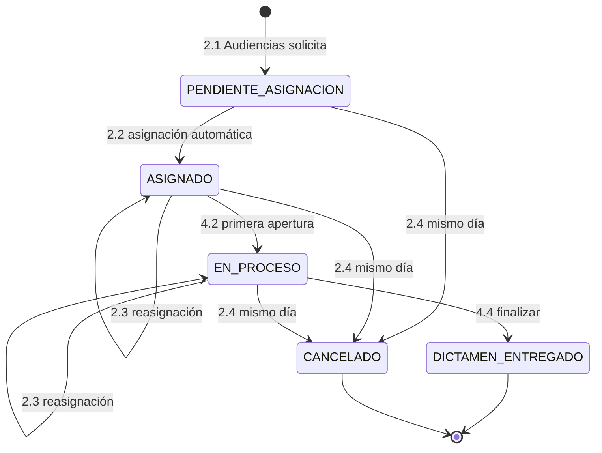

# Módulo de Peritajes — SGPJ, Gestión y Asignación de Peritajes

| Dato | Valor |
| :---- | :---- |
| Equipo | **Equipo 3** · rama `equipo-3` |
| Prefijo | Paquete `mx.edu.utez.sij.peritajes` · URLs `/peritajes/...` · vistas `src/main/webapp/WEB-INF/jsp/peritajes/` · tablas `per_` · roles `PERITAJES_*` |
| Fuente | DFR IEEE 830 v1.1 y BPMN v3 (`docs/modulos/peritajes/`) |
| Líder | Contreras Carbajal Marco Antonio |
| Project Manager | Escalona Ruiz Nathaly |
| Cliente | Narváez Figueroa José Christian |

> Sigue las reglas de `docs/ARQUITECTURA.md` y los contratos de `docs/CONTRATOS.md`.

---

## 1. Propósito

Mantener balanceada la carga de trabajo de los peritos. El módulo:

- recibe las solicitudes del **módulo de Audiencias** (Audiencias RF 6.1),
- asigna perito automáticamente por materia y menor carga,
- permite reasignar,
- y lleva el dictamen hasta "Dictamen Entregado".

El dictamen lo consultan Audiencias (RF 6.3) y Segunda Instancia (RF 6.1); se revisa en la audiencia.

---

## 2. Requerimientos y quién los implementa

| RF | Requerimiento | Implementación |
| :---- | :---- | :---- |
| 1.1 | Iniciar sesión | **Núcleo** (3 intentos, bloqueo de 15 min, recuperación por correo) |
| 1.2 | Cambio de contraseña | **Núcleo** (8 caracteres con mayúscula, minúscula y número) |
| 2.1 | Recepción de solicitud | Peritajes, con `SolicitudPeritajeApi.solicitar` (lo llama Audiencias) |
| 2.2 | Asignación automática | Peritajes |
| 2.3 | Asignación y reasignación manual | Peritajes |
| 2.4 | Cancelación | Peritajes, con `SolicitudPeritajeApi.cancelar` [Confirmar con Audiencias] |
| 3.1 – 3.4 | Catálogo de peritos | Peritajes (la cuenta se crea con `UsuarioService`). Diseño: bocetos de Figma (`Docs/figma/`) |
| 4.1 – 4.4 | Mis peritajes, expediente, realizar y finalizar dictamen | Peritajes (los documentos del expediente se leen con `ExpedienteApi`) |
| 4.5 | Consulta del dictamen por otros módulos | Peritajes, con `DictamenConsultaApi` (Audiencias 6.3 y Segunda 6.1) |
| 5.1 | Notificaciones | Peritajes decide cuándo; el núcleo muestra el aviso y envía el correo |
| 5.2 | Bitácora | Peritajes registra con `BitacoraService`; muestra solo la de su módulo |
| 5.3 | Panel de carga | Peritajes |

---

## 3. Roles

| Rol | Puede |
| :---- | :---- |
| `PERITAJES_ADMIN` | Ver todos los casos, reasignar, catálogo de peritos, bitácora y panel |
| `PERITAJES_PERITO_ADMIN` | Todo lo anterior + atender sus propios casos y hacer dictámenes |
| `PERITAJES_PERITO` | Solo sus propios casos y dictámenes |
| `SISTEMA_ADMIN` (administrador general, del núcleo) | Lo mismo que `PERITAJES_ADMIN`, **menos ver dictámenes** (no entra a "Mis peritajes" ni al expediente). Entra también a los otros cuatro módulos |

Todos entran por el **inicio de sesión único del núcleo** (`/login`). El administrador general ve la página con los cinco módulos; los demás van directo a su módulo y no ven los otros.

Los peritos no pertenecen a ningún juzgado (lo confirma Audiencias 2.4 y 6.1).

---

## 4. Modelo de datos

Base integrada `sistema_judicial` (script de todos los equipos). Las tablas de Peritajes terminan en `_Per`.
Script completo (versión 4): `docs/modulos/peritajes-bd-script-corregido.sql`. Crea la base **desde cero** (sin `ALTER TABLE`).
Scripts para bases anteriores: original → versión 2 con `peritajes-bd-cambios.sql`; versión 2 → versión 3 con `peritajes-bd-cambios-v3.sql`;
versión 3 → versión 3.1 con `peritajes-bd-cambios-v3.1.sql`. De la 3.1 a la 4 no hay script en el repositorio: se recrea la base.

**Versión 4 (cambios de Oficialía) en lo que lee Peritajes:**
- `materia_Ofc`, `oficialia_Ofc` y `juzgado_Ofc` tienen llave numérica (`id_materia`, `id_oficialia`, `id_juzgado`) en lugar de claves de texto.
- `perito_materia_Per.clave_materia` y `solicitud_perito_Aud.clave_materia` conservan el nombre, pero guardan el `id_materia` (INT). En Java, la materia es `Long` (`Materia.getId()`, `Peritaje.getMateriaId()`, `Perito.getMaterias()`).
- `documento_Ofc` se liga a la demanda por `id_demanda` (antes por `folio`).
Datos de prueba: `peritajes-bd-datos-prueba.sql`.

| Tabla | Para qué | Notas |
| :---- | :---- | :---- |
| `user_Per` + `Rol` | Usuarios del módulo (Administrador, Perito Administrador y Perito) | Un rol por usuario. El **perito es el usuario**: su `id_usuario` es el id del perito y su número de registro (`PER-0005`). `Status` = Activo/Inactivo. `carga_trabajo` = carga activa (6.1). El trigger copia correo y contraseña a `Login` |
| `educacion_especialidad_Per` | Especialidades del perito (texto libre, al menos una) | |
| `perito_materia_Per` | Materias del perito (las usa la asignación automática) | `clave_materia` guarda el `id_materia` de `materia_Ofc` (versión 4) |
| `solicitud_perito_Aud` | Solicitud que guarda Audiencias: demanda (`folio`) y **una** materia | Peritajes solo la lee |
| `peritaje_Per` | El peritaje de cada solicitud | El **folio del peritaje es su id**. `fecha_creacion` = fecha de solicitud |
| `asignacion_Per` | Asignación automática y reasignaciones | La **vigente es la de mayor `id_asignacion`**. Sin `id_usuario_cambio` = automática |
| `dictamen_Per` | Un dictamen por peritaje | Si se reasigna, el perito nuevo **continúa el mismo borrador** |
| `anexo_dictamen_Per` | Archivos del dictamen (máx. 25 MB, en la base) | |
| `bitacora_Per` | Bitácora del módulo | `id_usuario` NULL = el sistema |
| `notificacion_Per` | Avisos que se muestran en el inicio de cada usuario | El correo queda pendiente (núcleo) |
| `demanda_Ofc`, `persona_Ofc`, `expediente_Ofc`, `oficialia_Ofc`, `juzgado_Ofc`, `materia_Ofc`, `documento_Ofc` | Datos de la demanda para el expediente del perito | **Solo lectura** |

**Columnas que agregó Peritajes al script** (marcadas `CAMBIO PERITAJES`):
- `Login.intentos_fallidos` y `Login.bloqueado_hasta` (versión 3; antes estaban en `user_Per`): 3 intentos fallidos bloquean 15 minutos en cualquier módulo (RF 1.1).
- `bitacora_Per.nombre_usuario` y `rol_usuario` (versión 3): quién hizo el movimiento. El administrador general no está en `user_Per`, así que su `id_usuario` va NULL y su nombre queda aquí.
- `asignacion_Per` (versión 3): la asignación automática es la que no tiene perito saliente; en una manual, `id_usuario_cambio` NULL = el administrador general.
- `peritaje_Per.fecha_apertura`, `fecha_entrega` y `fecha_cancelacion` (RF 4.2, 4.4 y 2.4).
- `dictamen_Per.version`, para el autoguardado: `UPDATE dictamen_Per SET ..., version = version + 1 WHERE id_peritaje = ? AND version = ?`; si no actualiza ninguna fila, otra ventana guardó antes (409).
- `bitacora_Per.referencia`: folio del peritaje o número de registro del perito, para filtrar.
- `user_Per.carga_trabajo` (versión 3.1, sigue en la 4): carga activa del perito, la usa la asignación automática (6.1 y 6.2).
- Trigger `trg_user_Per_login_au`: al cambiar la contraseña (o el correo) en `user_Per` también se cambia en `Login` (RF 1.2). En la versión 2 del script el mismo trigger existe para `user_Ofc`, `user_Aud` y `user_Seg`, y busca en `Login` por el correo anterior.
- CHECK: `Login.intentos_fallidos >= 0`; `fecha_cancelacion` solo en "Cancelado" y `fecha_entrega` solo en "Dictamen Entregado". Por eso el código cambia el estado y la fecha en el mismo `UPDATE`.

**Especialidad ≠ materia.** La *especialidad* es el área o los estudios del perito (Psicología, Criminalística, …). La *materia* (Civil, Familiar, Mercantil, Penal) es la rama del derecho y es la que usa la asignación automática.

**Contraseñas:** cifradas con PBKDF2 (`nucleo/acceso/Contrasena`, viene con Java). Formato `pbkdf2$iteraciones$sal$hash`. Todos los módulos deben guardarla así en su `user_*`, porque el trigger la copia tal cual a `Login` y el login del núcleo la revisa ahí.

---

## 5. Estados



**Cómo los ve Audiencias** (RF 6.4):

| Peritajes | Audiencias |
| :---- | :---- |
| `PENDIENTE_ASIGNACION` | pendiente |
| `ASIGNADO`, `EN_PROCESO` | asignado |
| `DICTAMEN_ENTREGADO` | dictaminado |
| `CANCELADO` | cancelado |

---

## 6. Reglas de negocio en el código

### 6.1 Carga activa
**Asignado + En Proceso** de la asignación vigente. Se guarda en `user_Per.carga_trabajo` (desde la versión 3.1 del script).

- **Quién la cambia:** `PeritajeDao.actualizarCarga(con, peritoId)`, dentro de la misma transacción del cambio:
  - asignación automática: al perito elegido;
  - reasignación manual: al perito nuevo y al anterior;
  - entrega del dictamen: al perito que lo entregó.
  - Abrir el expediente (Asignado → En Proceso) no la cambia.
- **Cómo:** se vuelve a contar con `PeritajeDao.CARGA_ACTIVA` en lugar de sumar o restar 1, para que la columna no se desfase.
- **Quién la lee:** los candidatos de la asignación automática y de la reasignación (`PeritajeDao.candidatos`). El catálogo y la baja del perito siguen contando Asignado y En Proceso por separado, porque los muestran desglosados.

### 6.2 Recepción y asignación automática (2.1, 2.2) — `PeritajeDao.recibirSolicitudes`

Audiencias guarda su solicitud en `solicitud_perito_Aud` (demanda y una materia). **Cada vez que se abre el inicio, la lista de casos o "Mis peritajes"** (decisión del equipo), en un método `synchronized`:

1. Cada solicitud **sin peritaje** se guarda en `peritaje_Per` como "Pendiente de Asignación" con su fecha (bitácora "Recepción de solicitud"). `id_solicitud_perito` es UNIQUE: no se crea dos veces.
2. A cada peritaje **pendiente** se le buscan candidatos: peritos activos (`Status`) con rol de perito y con la materia.
   - Si no hay ninguno, se queda pendiente y se vuelve a intentar la siguiente vez (por ejemplo, al registrar o reactivar un perito de esa materia).
3. **Elegir perito:** el de menor carga activa; si hay empate, uno al azar.
4. En **una sola transacción**: el peritaje pasa a "Asignado", se agrega la fila en `asignacion_Per` (sin usuario = automática), la bitácora y el aviso al perito.

Pendiente con el Equipo 2: si Audiencias necesita la respuesta inmediata ("No hay peritos disponibles en esta materia", Audiencias 6.1), se hace el contrato `SolicitudPeritajeApi`.

### 6.3 Asignación y reasignación manual (2.3)
- **Validaciones del nuevo perito:** activo, con la materia del peritaje y distinto del actual.
- **Motivo:** obligatorio.
- **Carga:** no se valida.
- **Estado:** solo en `ASIGNADO` o `EN_PROCESO`, y **no cambia**.
- **Borrador:** el perito nuevo continúa el mismo borrador del dictamen (decisión del equipo).
- **Avisos:** al perito nuevo ("Se le asignó el peritaje X") y al descartado ("Ya no tiene asignado el peritaje X").
- **Registro:** fila nueva en `asignacion_Per` (perito saliente, usuario y motivo) y bitácora.

### 6.4 Cancelación (2.4)
- Solo si la fecha de solicitud es **hoy** (zona `America/Mexico_City`). Si no: "El peritaje solo puede cancelarse el mismo día de su solicitud".
- Pasa a `CANCELADO`; no se borra. Se avisa al perito.
- No se cancela uno en `DICTAMEN_ENTREGADO` [Propuesta].

### 6.5 Expediente (4.2)
- **Al abrirlo:** si está `ASIGNADO`, pasa a `EN_PROCESO`, se guarda `fecha_apertura` y se crea el borrador vacío del dictamen.
- **Contenido:** los datos de la demanda se leen directo de las tablas de Oficialía, solo lectura (`ExpedienteDao`).
- **Documentos de la demanda:** se listan, pero la descarga está pendiente: `documento_Ofc` solo tiene `ruta_archivo` (BLOB) y falta confirmar con Oficialía si es la ruta o el archivo.

### 6.6 Dictamen (4.3, 4.4)
- **Editor:** Quill por CDN.
- **Autoguardado:** cada 30 segundos y al salir [Propuesta], con `fetch` y la `version`. Si no coincide, 409 y aviso "Hay cambios más recientes en otra ventana".
- **Contenido:** se limpiará con `Jsoup.clean(html, Safelist.relaxed())` cuando jsoup esté en el `pom.xml`.
- **Archivos:** en `anexo_dictamen_Per` (PDF, DOC, DOCX, PNG, JPG; máximo 25 MB). Se pueden quitar mientras siga en borrador. Son opcionales [Confirmar].
- **Finalizar:**
  - El contenido no puede estar vacío.
  - En una sola transacción: dictamen `FINALIZADO` y peritaje `DICTAMEN_ENTREGADO`.
  - Después ya no se modifica.
- **Visibilidad:** desde ese momento, el dictamen aparece en `DictamenConsultaApi`.

### 6.7 Peritos (3.1 – 3.4)

Solo `PERITAJES_ADMIN` y `PERITAJES_PERITO_ADMIN`.

**Datos del perito**

| Campo | Obligatorio | Regla |
| :---- | :---- | :---- |
| Número de registro | — | Lo genera el sistema: es el id con formato `PER-0005`. No se captura ni se cambia |
| Nombre(s) | Sí | Máximo 50 caracteres (columna de `user_Per`) |
| Apellido paterno | Sí | Máximo 50 |
| Apellido materno | No | Máximo 50 |
| Correo institucional | Sí | Formato válido, único en **todo el sistema** (tabla `Login`). Con él inicia sesión. **No se cambia** |
| Tipo de usuario | Sí | Perito o Perito Administrador. Se elige en el registro; en la edición no se cambia |
| Especialidades | Sí, al menos una | Texto libre, máximo 100 caracteres cada una; se quitan las vacías y las repetidas |
| Materias de intervención | Sí, al menos una | Del catálogo de Oficialía (`materia_Ofc`) |

El teléfono se quitó (decisión del equipo: no está en la base).

- **Registro (3.1):**
  - El sistema genera una **contraseña temporal** y se la muestra al administrador **una sola vez** en el catálogo (no hay correo todavía). Se guarda cifrada.
  - Siempre empieza en **Activo**.
  - Duplicado por correo: "El perito ya existe: hay un usuario registrado con el correo ...".
  - Sin especialidad: "La especialidad es un campo obligatorio: capture al menos una".
  - Éxito: aviso "Registro exitoso".
- **Consulta (3.2):**
  - Búsqueda por nombre o número de registro; filtros por especialidad, materia y estado.
  - 25 por página; el administrador puede elegir 10, 25, 50 o 100.
  - Muestra el total general, de activos, de inactivos y por materia.
  - Sin coincidencias: "No se encontraron peritos".
- **Edición (3.3):** todo menos el correo, el número de registro y el tipo de usuario. Cambiar especialidades o materias no afecta los casos ya asignados. Éxito: "Datos actualizados correctamente".
- **Baja y reactivación (3.4):** desde la pantalla de edición, con confirmación (columna `Status`).
  - Se bloquea si la carga activa (Asignado + En Proceso) es mayor que 0: "El perito tiene N peritajes activos (folios). Primero deben reasignarse para poder darlo de baja".
  - Un perito inactivo no inicia sesión ni recibe asignaciones; si tenía la sesión abierta, la pierde en su siguiente clic.
- **Bitácora (5.2):** alta, edición y cambio de estado en `bitacora_Per`.

### 6.8 Inicio de sesión (1.1) y cambio de contraseña (1.2)

Los hace el **núcleo** para todo el sistema (propuesta del Equipo 3 a los integradores, `nucleo/acceso/`), con el diseño `docs/modulos/img.png`:

- `/login`: correo y contraseña contra la tabla `Login`; luego busca al usuario en `user_Ofc`, `user_Aud`, `user_Per` y `user_Seg` para saber su rol y si está activo. Mensajes de `ARQUITECTURA.md` 7.1: "Credenciales incorrectas", "Cuenta inactiva" y "Cuenta bloqueada temporalmente".
- 3 intentos fallidos bloquean la cuenta 15 minutos (`Login.intentos_fallidos`, `Login.bloqueado_hasta`).
- Al entrar: el administrador general va a `/` (los cinco módulos); los demás, directo a su módulo según el inicio de su rol (`PERITAJES_*` → `/peritajes`).
- `FiltroNucleo`: sin sesión manda a `/login`; a `/<modulo>/**` solo entran el administrador general y los roles de ese módulo (403 si no). En cada petición vuelve a leer al usuario: si lo dieron de baja, pierde la sesión.
- `/cuenta/password`: cambio de contraseña con la sesión iniciada (actual, nueva y confirmación). Se cambia en la tabla `user_*` del usuario y el trigger la copia a `Login`.
- `/recuperar`: pantalla "Recupere su acceso". Siempre muestra el mismo aviso "Solicitud recibida", exista o no la cuenta.
  - Si el correo es de una cuenta **activa**, manda un enlace a `/recuperar/restablecer?token=...`: sirve **una sola vez** y vence en **15 minutos** (`TokenRecuperacion`, en memoria). Pedir otro invalida el anterior.
  - En `/recuperar/restablecer` se escribe la contraseña nueva (misma regla que 1.2). Se guarda en la tabla `user_*` (el trigger la copia a `Login`) y se quita el bloqueo por intentos.
  - El correo lo envía `nucleo/correo/Correo` (Jakarta Mail). Configuración en `src/main/resources/correo.properties` (no se sube; copiar `correo.example.properties`). Con `correo.activo=false` no se envía: el mensaje con el enlace sale en la consola de Tomcat.
- `/logout`: botón "Cerrar sesión" del layout.
- Peritajes (`PeritajesAuth`) solo revisa el permiso de cada pantalla con el usuario del núcleo (`Acceso.usuario(request)`).

---

## 7. Contratos

**Ofrece** (detalle en `docs/CONTRATOS.md`):

| Contrato | Lo usan | Métodos |
| :---- | :---- | :---- |
| `SolicitudPeritajeApi` | Audiencias | `solicitar`, `cancelar`, `solicitudesDeExpediente` |
| `DictamenConsultaApi` | Audiencias, Segunda Instancia | `dictamen(folio)`, `dictamenesDeExpediente(numeroExpediente)` |

**Necesita:**

| De | Contrato | Para qué |
| :---- | :---- | :---- |
| Oficialía | `ExpedienteApi` | Validar el expediente y mostrar sus documentos (4.2) |
| Oficialía | `CatalogoJudicialApi` | Materias para las especialidades y los peritajes |
| Núcleo | `UsuarioService`, `SesionService`, `NotificacionService`, `BitacoraService`, `ArchivoService` | Cuentas, sesión, avisos, bitácora, archivos |

---

## 8. Rutas (`/peritajes`)

**Roles:** `ADM` = PERITAJES_ADMIN · `PA` = PERITAJES_PERITO_ADMIN · `PER` = PERITAJES_PERITO · `AG` = SISTEMA_ADMIN

| Método | URL | Roles | Vista / acción |
| :---- | :---- | :---- | :---- |
| GET | `/peritajes` | ADM, PA, PER, AG | Dashboard según el rol (tarjetas) y avisos |
| GET | `/peritajes/casos` | ADM, PA, AG | Lista `?q&materia&estado&peritoId&page`; 25 por página |
| GET | `/peritajes/casos/detalle?id=` | ADM, PA, AG | Detalle, historial y formulario de reasignación |
| POST | `/peritajes/casos/reasignar` (con `id`) | ADM, PA, AG | `peritoId`, `motivo` |
| GET | `/peritajes/peritos` | ADM, PA, AG | Catálogo `?q&especialidad&materia&estado&page&size` |
| GET / POST | `/peritajes/peritos/nuevo` | ADM, PA, AG | Registro |
| GET / POST | `/peritajes/peritos/editar?id=` | ADM, PA, AG | Edición, carga activa y estado (no hay vista de detalle aparte) |
| POST | `/peritajes/peritos/estado` (con `id`) | ADM, PA, AG | Baja o reactivación (`activo` = `true` o `false`) |
| GET | `/peritajes/mis-casos` | PER, PA | Solo los suyos |
| GET | `/peritajes/mis-casos/detalle?id=` | PER, PA | Expediente y editor del dictamen en la misma pantalla, como en el boceto (la primera apertura pasa a En Proceso) |
| GET | `/peritajes/mis-casos/documento?id=&archivoId=` | PER, PA | Descargar un documento de la demanda (pendiente: confirmar `documento_Ofc` con Oficialía) |
| POST | `/peritajes/mis-casos/dictamen/autoguardado` | PER, PA | `fetch` con los campos `id`, `contenido`, `version` y `manual` (como formulario; sin JSON). Responde JSON: 200 `{version, guardadoEn}`, 409 si otra ventana guardó antes, 401 si la sesión terminó |
| POST | `/peritajes/mis-casos/dictamen/archivos` (con `id`) | PER, PA | Subir archivo (máximo 25 MB) |
| GET | `/peritajes/mis-casos/dictamen/archivo?id=&archivoId=` | PER, PA | Descargar un archivo del dictamen |
| POST | `/peritajes/mis-casos/dictamen/archivos/eliminar` (con `id` y `archivoId`) | PER, PA | Quitar archivo |
| POST | `/peritajes/mis-casos/dictamen/finalizar` (con `id`) | PER, PA | Entregar |
| GET | `/peritajes/bitacora` | ADM, PA, AG | Bitácora del módulo `?desde&hasta&usuario&evento&q&page` |
| GET | `/peritajes/panel` | ADM, PA, AG | Carga por perito y por materia (pendiente) |

`AG` = administrador general (`SISTEMA_ADMIN`): entra a todo lo de `ADM` y a nada de `/peritajes/mis-casos/**` (no ve dictámenes).
Sin sesión, `FiltroNucleo` manda a `/login`. Con sesión pero sin el rol: 403. El menú lateral (`menu.jsp`) solo muestra las opciones del rol.
El login, la recuperación, el cambio de contraseña y el cierre de sesión son rutas del núcleo (`/login`, `/recuperar`, `/recuperar/restablecer`, `/cuenta/password`, `/logout`).

---

## 9. Estructura de carpetas

```text
peritajes/
├── controller/   PeritajesAuth (permiso de cada pantalla con el usuario del núcleo),
│                 InicioPeritajesServlet (dashboard por rol),
│                 PeritoListarServlet, PeritoRegistrarServlet, PeritoEditarServlet, PeritoEstadoServlet,
│                 PeritoFormSupport (lee y valida el formulario),
│                 CasoListarServlet, CasoDetalleServlet, CasoReasignarServlet,
│                 MisCasosListarServlet, MisCasosDetalleServlet,
│                 DictamenAutoguardadoServlet, DictamenArchivoSubirServlet, DictamenArchivoDescargarServlet,
│                 DictamenArchivoEliminarServlet, DictamenFinalizarServlet, BitacoraPeritajesServlet
│                 PanelServlet (pendiente)
├── model/        Perito, Peritaje, EstadoPeritaje (enum), Dictamen, ArchivoDictamen, HistorialAsignacion,
│   │             TipoAsignacion (enum), CandidatoAsignacion, RegistroBitacora, Notificacion, FormatoFecha,
│   │             UsuarioPeritajes, Materia, Expediente, DocumentoExpediente
│   └── dao/      PeritoDao, PeritajeDao, DictamenDao, HistorialAsignacionDao, BitacoraDao,
│                 NotificacionDao, MateriaDao, ExpedienteDao (JDBC con ConexionBD), Jdbc (ayudas), BaseDatosException
│                 (pendiente) las clases que implementen SolicitudPeritajeApi y DictamenConsultaApi cuando existan
│                 los contratos; usan PeritajeDao y DictamenDao
src/main/webapp/WEB-INF/jsp/peritajes/  inicio.jsp  menu.jsp  peritos/ (lista, registro, editar)
                                        casos/ (lista, detalle)  mis-casos/ (lista, expediente)  bitacora.jsp  panel.jsp (pendiente)
src/main/webapp/recursos/peritajes/     css/peritajes.css  js/peritos.js  js/casos.js  js/dictamen.js
docs/modulos/                           peritajes-bd-script-corregido.sql  peritajes-bd-cambios.sql  peritajes-bd-cambios-v3.sql
                                        peritajes-bd-datos-prueba.sql  img.png (diseño del login)

Propuesta para el núcleo (B1-a, la revisan los integradores):
src/main/java/mx/edu/utez/sij/nucleo/acceso/   Contrasena, UsuarioSesion, Acceso, AccesoDao, ResultadoAcceso,
                                        LoginServlet, LogoutServlet, RecuperarServlet, CuentaPasswordServlet,
                                        RestablecerServlet, TokenRecuperacion
src/main/java/mx/edu/utez/sij/nucleo/correo/   Correo (Jakarta Mail; configuración en correo.properties)
src/main/java/mx/edu/utez/sij/nucleo/web/      FiltroNucleo (sesión y permiso por módulo), InicioServlet (/ por rol)
src/main/webapp/WEB-INF/jsp/nucleo/       login.jsp  recuperar.jsp  restablecer.jsp  password.jsp  inicio.jsp
src/main/webapp/WEB-INF/tags/             layout-acceso.tag (nuevo)  layout.tag (cerrar sesión y cambiar contraseña)
                                        layout.tag, layout-publico.tag y layout-acceso.tag: ?v= en estilos.css y comun.js
src/main/webapp/WEB-INF/tags/nucleo/      contrasena.tag (nuevo: campo con ojo)  icono.tag (íconos ojo y ojo-tachado)
src/main/webapp/recursos/nucleo/css/      acceso.css (nuevo: login y recuperación)  estilos.css (.sij-campo-contrasena)
src/main/webapp/recursos/nucleo/js/       comun.js (data-ver-contrasena: el ojo de <n:contrasena>)
src/main/java/mx/edu/utez/sij/nucleo/bd/       ConexionBD (quita espacios al final de bd.properties)
```

**Pendientes con el núcleo y otros módulos** (cada clase lo dice en su comentario):
- El inicio de sesión es una propuesta para el núcleo hecha por el Equipo 3 (ver arriba): los integradores la revisan y la aceptan o la cambian.
- `ExpedienteDao` y `MateriaDao` leen tablas de Oficialía con SQL; si Oficialía publica `ExpedienteApi` y `CatalogoJudicialApi`, se cambian por los contratos.
- Los avisos se guardan en `notificacion_Per` y se ven en el inicio; falta el envío por correo.

---

## 10. Correcciones sugeridas al DFR

| Sección | Hoy dice | Sugerencia |
| :---- | :---- | :---- |
| 1, 2.1, 2.4, 3.1 | Depende del "Sistema de Gestión y Control de Audiencias" ya existente | "Se integra con el **módulo de Audiencias (SGCA)** del Sistema Judicial Integral" |
| 2.1 y 2.4 (actor) | Sistema | Módulo de Audiencias |
| 2.1 Datos de entrada | Folio de la demanda | Número de expediente\*, Audiencia\*, Materia(s)\* (es lo que envía Audiencias 6.1). El sistema genera el **folio del peritaje** |
| 2.5 Suposiciones | Siempre hay un perito disponible | "Si no hay perito activo de la materia, se informa 'No hay peritos disponibles en esta materia'" (lo pide Audiencias 6.1) |
| 2.4 Cancelación | La pide el sistema externo | Confirmar con el Equipo 2: hoy su DFR no tiene ese requerimiento (pendiente 10) |
| 1.1 y 1.2 | Requerimientos propios | Nota: "Se implementan con el control de acceso común". Las reglas comunes: 3 intentos, bloqueo de 15 min, contraseña de 8 caracteres |
| 3.1 Interfaces | Interfaz con un sistema externo | Interfaces internas `SolicitudPeritajeApi` y `DictamenConsultaApi` |
| 4.5 | Opcional, por confirmar | Confirmado: lo usan Audiencias 6.3 y Segunda 6.1 |
| 3.3.8 Tecnologías | Vacío | Java 21, Jakarta EE 11 (Servlets + JSP + JSTL, MVC) en Tomcat 11, Bootstrap 5, JDBC con DAO, MySQL 8 |
| Materias | Civil, Familiar, Mercantil, Penal | Vienen del catálogo de Oficialía (pendiente 2) |
| Carga activa (2.2, 2.3, 3.4, 5.3, Glosario) | Solo "Asignado" | "Asignado y En Proceso" |
| 2.4 Cancelación | "Se elimina del sistema" | Pasa a "Cancelado" y se conserva |
| 3.1 Datos de entrada | Identificador de perito\*, Nombre completo\*, Especialidad(es)\*, Correo\*, Contraseña\*, Materia\* | Número de registro (PER-0000)\*, Nombre(s)\*, Apellido paterno\*, Apellido materno, Correo institucional\*, Teléfono de contacto\*, Especialidad(es)\*, Materia(s)\*. **Sin contraseña:** el núcleo genera una temporal y la envía por correo; se cambia en el primer inicio de sesión |
| 3.1 Reglas | "Contraseña segura, especificar" | Se quita: la contraseña la maneja el control de acceso común (8 caracteres con mayúscula, minúscula y número) |
| 3.1, 3.3 y 2.2 | Usa "especialidad" y "materia" como sinónimos | **Especialidad:** área o estudios del perito, texto libre, una o varias. **Materia:** Civil, Familiar, Mercantil o Penal; es la que usa la asignación |
| 3.1 Criterios | "sin asignarle al menos una especialidad" | Se exige al menos una especialidad **y** al menos una materia |
| 3.3 Datos de entrada | Id\*, Nombre completo\*, Especialidad(es)\*, Correo\* | El **correo y el número de registro no se editan**. Se editan nombre, apellidos, teléfono, especialidades y materias. Quitar "el correo no puede repetirse con otro perito" (ya no cambia) |
| 3.2 Datos de entrada | Nombre, Id de perito, Especialidad | Agregar filtros por materia y por estado (Activo/Inactivo), como en el boceto |
| 3.4 Reglas | Se bloquea con peritajes "Asignado" | "Asignado" o "En Proceso" (regla de negocio 8 del mismo DFR) |
| 3.4 | Sin pantalla definida | La baja y la reactivación se hacen desde la pantalla de edición, con confirmación (3.3.10) |

## 11. Pendientes

- Que los integradores y los otros equipos acepten los cambios al script (`peritajes-bd-script-corregido.sql`, versión 3).
- Inicio de sesión único (propuesta al núcleo). Para que funcione en todos los módulos:
  - cada equipo guarda las contraseñas con `Contrasena.cifrar(...)` del núcleo;
  - los roles de la tabla `Rol` empiezan con el nombre de su módulo (`OFICIALIA_`, `AUDIENCIAS_`, `PERITAJES_`, `SEGUNDA_`, `COPIAS_`);
  - el administrador general (`SISTEMA_ADMIN`) vive en `user_Ofc`;
  - con este cambio, las pantallas de **todos** los módulos piden iniciar sesión.
- Recuperación de contraseña por correo: hecha (propuesta al núcleo, 6.8). Falta que los integradores la acepten, junto con la dependencia de Jakarta Mail en el `pom.xml`.
- Mensajes de confirmación de 3.1, 3.3 y 3.4: el DFR no da el texto exacto; hoy se usan los de la sección 6.7.
- ¿Al menos un anexo obligatorio al finalizar? (hoy son opcionales).
- Cancelación de solicitudes con el Equipo 2 (pendiente 10). La columna `fecha_cancelacion` ya existe. Al cancelar hay que llamar `PeritajeDao.actualizarCarga` para restarle el peritaje al perito.
- `documento_Ofc.ruta_archivo`: confirmar con Oficialía si es la ruta o el archivo, para poder descargarlo.
- Los nombres de materia, distrito, juzgados y oficialías de los datos de prueba (se buscan por nombre desde la versión 4): confirmar con Oficialía.
- Panel de carga de trabajo (RF 5.3).
